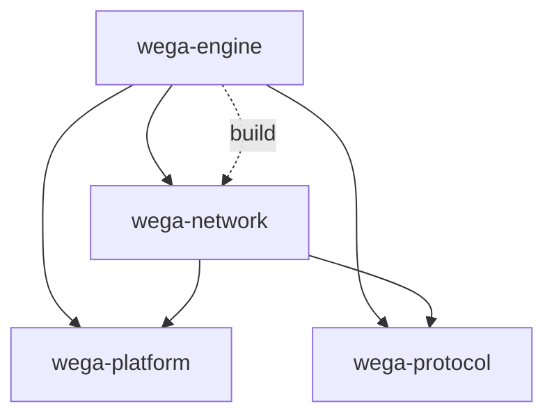

# Dependency graph baseline (before Wave 1 extractions)

Generated by `wega-dependency-graph` from `engines/Cargo.toml` at commit `c147bd3`.



```text
manifest: engines/Cargo.toml
wega-engine 0.1.0
  -> wega-network (normal)
  -> wega-network (build)
  -> wega-platform (normal)
  -> wega-protocol (normal)
wega-network 0.1.0
  -> wega-platform (normal)
  -> wega-protocol (normal)
wega-platform 0.1.0
  (no workspace dependencies)
wega-protocol 0.1.0
  (no workspace dependencies)
manifest: Cargo.toml
wega 0.1.0-alpha.1
  (no workspace dependencies)
path dependency outside this workspace: wega -> wega-network (normal)
path dependency outside this workspace: wega -> wega-platform (normal)
path dependency outside this workspace: wega -> wega-protocol (normal)
```
