# Crate Initialization Plan (Phase 2 — finalized)

**Status: APPROVED PLAN — NOTHING IMPLEMENTED.** No crate, Cargo manifest, workspace member or source move results from this document. It supersedes the draft of the same name, applies the ten review decisions, corrects the dependency graph, and adds the Phase 2 execution plan.

**Wave 1 implementation status: COMPLETE** — see [`wave1-implementation-report.md`](./wave1-implementation-report.md). Corrections discovered during implementation:

- `cargo fmt` for the engines workspace needs `--all`: `cargo fmt --manifest-path engines/Cargo.toml --all --check`.
- `wega-security` uses `sha2 0.11` (the engine's version) and exposes modules `csp` and `secure_context`; `Csp` became `pub`.
- `wega-permissions` also needs `url 2.5` and depends on `wega-network` (for `Policy`) as planned.
- `wega-storage` and `wega-cookies` carry the same dependency versions as `wega-network` (`rusqlite 0.41.1`, `sha2 0.10`, `cookie_store =0.22.1`, `publicsuffix =2.3.0`). `wega-network` kept `rusqlite`/`sha2` (still used by `services.rs`) and dropped `cookie_store`/`publicsuffix`.
- Tools workspace placement decided: standalone `engines/tools/` workspace with its own lockfile, excluded from `engines` (`exclude = [..., "tools"]`).
- `engines/wega/src/public_suffix_list.dat` remains in place (unreferenced; not deleted).

Related: [`module-map.md`](./module-map.md), [`migration-phases.md`](./migration-phases.md).

## 1. Decisions applied

| # | Decision | Effect in this plan |
|---|---|---|
| 1 | `services/cache` → `services/storage`; HTTP caching stays separate | Directory renamed (docs only). `wega-storage` owns Cache Storage, Cache API, IndexedDB. HTTP caching stays in `services/http` (`wega-network`). |
| 2 | `wega-adapter-skia` is the sole Skia backend owner; Canvas semantics stay outside | `graphics/raster-skia` is documentation-only (merged). New `webapi/canvas` holds API semantics. Skia types must not leak through the adapter's public API. |
| 3 | `runtime/process` documentation-only | `wega-platform` stays the OS process/IPC implementation; `wega-protocol` the wire contract. |
| 4 | Defer foundation crates | All 7 `foundation/*` leaves are D. No `wega-foundation`, `wega-geometry`, `wega-metrics`. |
| 5 | Add `webapi/canvas`, `webapi/webgl`, `webapi/media` | Created with READMEs; implementations stay in `engines/wega`. |
| 6 | Naming: `wega-adapter-*`, `wega-js-*` | Applied below. |
| 7 | Keep WebIDL location | `tools/webidl` stays; see §9 for what is and is not verified. |
| 8 | `cargo_metadata` allowed for dev-only architecture tools | Tools only; never a production dependency. |
| 9 | Leave dependency version differences | No version edits anywhere. |
| 10 | `#![forbid(unsafe_code)]` default in new crates | Exceptions must be documented in the crate README (none planned in Waves 1–3; `wega-adapter-skia`/`-v8` are the candidates and must justify any `unsafe` individually). |

## 2. Method and classification codes

Findings come from reading manifests, `cargo metadata --no-deps` for the `engines/` workspace, `grep` of cross-crate paths, per-file line counts, and the CI workflows. Line counts are approximate. Items marked **(verify)** are unconfirmed.

| Code | Meaning |
|---|---|
| **A** | Independent Cargo library crate (`A?` = conditional on a validation gate) |
| **B** | Internal module in another named crate |
| **C** | Adapter around an existing implementation |
| **D** | Documentation-only placeholder |

## 3. Actual repository state

### 3.1 Workspaces

| Workspace | Location | Members / notes |
|---|---|---|
| Root | `Cargo.toml` | Package `wega` (Servo-based app). Path deps on `engines/protocol` (required), `engines/platform` and `engines/network` (optional, via `desktop`). Bins `wega-inventory`, `wega-webidl` (`tools/webidl/main.rs`, feature `webidl-tools`). |
| Engines | `engines/Cargo.toml` | `wega` (package **`wega-engine`**), `network`, `platform`, `protocol`; `exclude = ["vendor","v8-spike"]`; own `Cargo.lock`; `[patch.crates-io]` redirects `deno_*`, `blitz-*`, `stylo`, `anyrender_skia`, `skia-bindings` to `engines/vendor/*`. |
| `engines/v8-spike` | standalone `[workspace]` | Excluded. |
| `tools/webidl` | package `wega-webidl` | Its own `Cargo.toml`, no `[workspace]`; compiles the same `main.rs` as the root bin. |

### 3.2 Existing crates and edges

```
wega-engine ──► wega-network ──► wega-platform
     │               │
     ├───────────────┴──────► wega-protocol
     └──────────────────────► wega-platform
```

| Crate | ~Lines | Content |
|---|---|---|
| `wega-protocol` | 3,470 | Wire commands/events, `Origin`/`Principal`, browsing contexts, identities. `forbid(unsafe_code)`. Deps: `serde`, `serde_json`, `url`. |
| `wega-platform` | 4,750 | Process launch, sandbox, supervision, IPC pipes, `FrameStore`, metrics. All native code. |
| `wega-network` | 5,360 | HTTP client, policy, HSTS, CORS, `Broker`/`Remote`/`SessionHandle`, WebSocket, cookies, Cache Storage, Cache API, IndexedDB, font lookup. |
| `wega-engine` | 18,070 | DOM host over Blitz, V8/Deno glue, canvas, WebGL, media, workers, CSP, permissions, view/pipeline. |

### 3.3 Code-level findings that shape the extractions (new in this revision)

1. **Existing seams worth reusing** (validated by code, not speculation):
   - `NativeHost` trait (`engines/wega/src/native_ops.rs:44`) — host callbacks (`fetch`, cookies, origin, referrer, WebSocket headers) implemented by `Dom` in `v8.rs`. Natural base for the `wega-js-runtime`/`wega-js-bindings` host contract. It currently names `wega_network::Request/Response`.
   - `ScriptHost` trait (`engines/wega/src/script.rs:36`).
   - `anyrender::PaintScene` / `ImageRenderer` (used in `raster.rs`) — an existing display-list-like seam between Blitz paint and Skia.
   - `stylo_taffy` (in `blitz-dom`) — an existing adapter between Stylo computed style and Taffy layout. Precedent for adapter-based CSS↔layout integration.
2. **`cors.rs` is not extractable yet:** it uses `use super::*` from `network/src/lib.rs`, depending on `Request`/`Policy` types. It stays in `wega-network`.
3. **`security_context.rs` mixes concerns:** `trustworthy()` is pure (`url` only); `configure()` calls `deno_core::v8`. Only the pure part can move to `wega-security`; `configure()` stays with the engine/V8 adapter.
4. **`csp.rs` is clean** (`sha2`, `url`) but `Csp` is `pub(crate)`; extraction must make it `pub`. Users: `script.rs`, `dom.rs`, `view.rs`, `workers/{mod,runtime}.rs`.
5. **`permissions/registry.rs` depends on network policy:** `query`/`request` take `&crate::network::NetworkPolicy` (= `wega_network::Policy`) and read `blocked_hosts`. `wega-permissions` therefore depends on `wega-network` initially (no cycle, because `wega-network` does not depend on it).
6. **Storage modules are clean:** `cache_storage.rs` ↔ `cache_api.rs` reference each other only; deps are `rusqlite`, `serde`, `serde_json`, `sha2`, `url`. `services.rs` in `wega-network` uses `CacheStorage`. `IndexedDB` is re-exported but has **no in-repo consumer** besides its own tests.
7. **`cookies.rs` is clean** (`cookie_store`, `publicsuffix`, `serde`, `url`) with inline tests; 21 references in `lib.rs`/`services.rs`. Only `network/src/cookies.rs` loads `public_suffix_list.dat` (`include_bytes!`); the copy in `engines/wega/src` has no reference in source or manifests (likely dead — verify before deleting).
8. **Direct Skia use outside the planned adapter:** `canvas/*` (≈19 `skia_safe` references), `webgl/context.rs` (6), `raster.rs` (1). Decision 2 requires a drawing-surface interface before Skia can be owned solely by the adapter.
9. **Blitz coupling counts** (lines referencing `blitz_dom`/`blitz_traits`/`BaseDocument`/`DocumentMutator`): `dom.rs` 25, `view.rs` 21, `parser.rs` 5, `script.rs` 2. Small enough to enumerate for a contract gate.
10. **CI test baseline:** `standalone-engine-validation.yml` runs `cargo test --locked --manifest-path engines/Cargo.toml --target-dir target/wega-engine --workspace --all-targets -- --test-threads=1`, plus broker-mode runs of `-p wega-engine --test security --test forms --test scripts --test documents --test history`. `ci.yml` covers the root crate.
11. Version skew (`sha2` 0.10/0.11, `base64` 0.22/0.23, `getrandom` 0.3/0.4) is left unchanged (decision 9). New crates must pin the **same version as their source crate** so no resolution changes.

## 4. Ownership overlaps — resolved

### 4.1 Network / HTTP / storage

| Concern | Owner after Phase 2 |
|---|---|
| HTTP client, policy, HSTS, CORS, **HTTP caching**, broker, WebSocket, font lookup (temporary) | `wega-network` = `services/http` (name and path unchanged; root depends on it by path) |
| Cookies | `wega-cookies` |
| Cache Storage, Cache API, IndexedDB | `wega-storage` (`services/storage`) |
| Fetch/timers API surfaces | documentation-only; behavior from `deno_fetch`/`deno_web` |

### 4.2 Process / protocol / platform

`wega-platform` = OS process, sandbox, supervision, IPC, frame store, process metrics. `wega-protocol` = wire contract and `Origin`/`Principal`. `runtime/process` is documentation-only. `foundation/ids|events|metrics` are deferred; none of these will be duplicated into new crates.

### 4.3 Adapters vs vendor

`engines/vendor/*` is patched third-party source (hashes/patches in `engines/vendor/sources.json`) and is never a migration source or destination. `engines/adapters/*` is Wega-owned wrapper code and the only place third-party engine types may appear in a public API. Adapters list normal pinned dependencies (e.g. `deno_core = "=0.413.0"`); the `[patch.crates-io]` table is untouched.

## 5. Classification of all 72 planned modules

| # | Planned module | Class | Package / host | Existing source (eventual) | Notes |
|---|---|---|---|---|---|
| 1 | foundation/types | D | (deferred) | — | Decision 4: no crate until stable shared interface has multiple consumers. |
| 2 | foundation/ids | D | (deferred) | `protocol/src/identity.rs` stays | Same. |
| 3 | foundation/errors | D | (deferred) | `ProtocolError`/`ErrorCode` stay in protocol | Same. |
| 4 | foundation/geometry | D | (deferred) | — | Same. Engine uses `kurbo`/`euclid` via external deps. |
| 5 | foundation/config | D | (deferred) | — | Same. |
| 6 | foundation/events | D | (deferred) | — | Same. `protocol/src/queue.rs` is wire-level. |
| 7 | foundation/metrics | D | (deferred) | `platform` metrics stay | Same. |
| 8 | dom/core | A | `wega-dom` (W2) | `wega/src/dom.rs` | Contract limited to what `dom.rs` uses of Blitz; gate G2-DOM. |
| 9 | dom/events | B | `wega-dom` | event dispatch in `dom.rs` | Same gate. |
| 10 | dom/mutation | B | `wega-dom` | `dom/observers.js`, `dom.rs` | Same gate. |
| 11 | dom/traversal | B | `wega-dom` | `dom.rs` | Same gate. |
| 12 | html/parser | A | `wega-html` (W2) | `wega/src/parser.rs` (335) | Gate G2-HTML; no `wega-dom` dependency required if the sink is a trait. |
| 13 | html/treebuilder | B | `wega-html` | tree sink in `parser.rs` | `html5ever` does tree construction. |
| 14 | css/values | D | — | Stylo provides | Revisit in W3 gate. |
| 15 | css/parser | D | — | Stylo/cssparser | Same. |
| 16 | css/selectors | D | — | Stylo `selectors` | Same. |
| 17 | css/style-engine | C | `wega-adapter-stylo` (W3) | `style::` use in `dom.rs` (media-query parsing) | Contract crate `wega-css` only if G3-CSS passes. |
| 18 | css/cache | D | — | Stylo-internal |  |
| 19 | css/invalidation | D | — | Stylo-internal |  |
| 20 | layout/core | A? | `wega-layout` (W3, conditional) | none separable | Blitz uses Taffy via `stylo_taffy`; contract only if G3-LAYOUT passes. |
| 21 | layout/block | D | — | Blitz/Taffy |  |
| 22 | layout/flex | D | — | Blitz/Taffy |  |
| 23 | layout/grid | D | — | Blitz/Taffy |  |
| 24 | layout/inline | D | — | Blitz/Parley |  |
| 25 | layout/text | D | — | Blitz/Parley |  |
| 26 | layout/invalidation | D | — | Blitz |  |
| 27 | graphics/display-list | A? | `wega-display-list` (W3, conditional) | none; Blitz paints through `anyrender::PaintScene` | Gate G3-DL: wrap/mirror `anyrender` or skip. |
| 28 | graphics/paint | C | `wega-adapter-blitz` (W3) | `blitz-paint` use in `view.rs`, `raster.rs` |  |
| 29 | graphics/raster-skia | D | → `wega-adapter-skia` | `raster.rs` | Merged (decision 2). |
| 30 | graphics/compositor | D | — | none |  |
| 31 | graphics/gpu | D | — | none |  |
| 32 | graphics/image | D | — | Blitz / `image` crate |  |
| 33 | graphics/fonts | D | — | `fontdb` use in `network/src/services.rs` | Eventual home of that code. |
| 34 | javascript/runtime | A | `wega-js-runtime` (W2) | `v8.rs`, `script.rs` (`ScriptHost`), `module_loader.rs` | Gate G2-JS. |
| 35 | javascript/dom-bindings | B | `wega-js-bindings` | `dom/bindings.js`, `dom/v8-bridge.js`, `dom/generated` |  |
| 36 | javascript/events | B | `wega-js-bindings` | `event_loop.rs` |  |
| 37 | javascript/bindings | A | `wega-js-bindings` (W2) | `native_ops.rs` (`NativeHost`), `dom/*.js` |  |
| 38 | javascript/webidl | A (exists) | `wega-webidl` at `tools/webidl` — **not moved** | `tools/webidl/*` | Decision 7. |
| 39 | webapi/core | D | — | `encoding.rs` (verify) |  |
| 40 | webapi/fetch | D | — | `deno_fetch` + `network.rs` |  |
| 41 | webapi/timers | D | — | `deno_web` |  |
| 42 | webapi/storage | B | `wega-webapi` (later) over `wega-storage` | `dom/cache.js`, `deno_webstorage` |  |
| 43 | webapi/workers | A | `wega-workers` (W2) | `wega/src/workers/*` (2,384) | After `wega-js-runtime`. |
| 44 | webapi/canvas | D | — | `wega/src/canvas/*` (1.3k; direct `skia_safe` use) | New (decision 5). Not migrated. |
| 45 | webapi/webgl | D | — | `wega/src/webgl/*` (1.6k) | New (decision 5). Not migrated. |
| 46 | webapi/media | D | — | `wega/src/media/*` (0.9k) | New (decision 5). Not migrated. |
| 47 | services/http | A (exists) | **`wega-network`** | `engines/network` | No new crate. Keeps HTTP caching. |
| 48 | services/storage | A | `wega-storage` (W1) | `network/src/cache_storage.rs`, `cache_api.rs`, `indexeddb.rs` | Renamed from services/cache (decision 1). |
| 49 | services/cookies | A | `wega-cookies` (W1) | `network/src/cookies.rs`; `public_suffix_list.dat` |  |
| 50 | services/downloads | D | — | root `src/downloads.rs` (Servo-coupled) |  |
| 51 | services/security | A | `wega-security` (W1) | `wega/src/csp.rs`; `trustworthy()` from `security_context.rs` | `cors.rs` stays in `wega-network` (entangled). |
| 52 | services/permissions | A | `wega-permissions` (W1) | `wega/src/permissions/*` | Depends on `wega-network::Policy` initially. |
| 53 | services/navigation | D | — | root `navigation.rs`; `protocol/browsing.rs` |  |
| 54 | services/history | D | — | `protocol/browsing.rs`, root `session.rs` |  |
| 55 | services/bookmarks | D | — | none dedicated |  |
| 56 | runtime/tab-manager | D | — | root `browser.rs`/`application.rs` |  |
| 57 | runtime/process | D | — | `wega-platform` + `wega-protocol` stay | Decision 3. |
| 58 | runtime/scheduler | B | stays in `wega-engine` | `event_loop.rs` |  |
| 59 | runtime/memory | B | stays in `wega-engine` | `platform` metrics; root `resources.rs` |  |
| 60 | runtime/orchestration | A (exists) | **`wega-engine`** | `view.rs`, `document_host.rs`, `components.rs` | Composition root. |
| 61 | adapters/blitz | C | `wega-adapter-blitz` (W3) | Blitz use in `dom.rs`, `view.rs`, `parser.rs`, `script.rs`, `raster.rs` | Decision 6 naming. |
| 62 | adapters/stylo | C | `wega-adapter-stylo` (W3) | `style::` use in `dom.rs` |  |
| 63 | adapters/skia | C | `wega-adapter-skia` (W2) | `raster.rs`; Skia calls in `canvas/*`, `webgl/context.rs` | Sole Skia owner. |
| 64 | adapters/v8 | C | `wega-adapter-v8` (W2) | `v8.rs`, `native_ops.rs`, `script.rs`, `module_loader.rs`, `web.rs`, `web_extensions.rs`, `extension_adapter.rs` |  |
| 65 | tests/fixtures | D | — | `tests/fixtures/*` |  |
| 66 | tests/integration | D | — | `engines/wega/tests/*.rs` (31 files) | Tests move with their crate. |
| 67 | tests/compatibility | D | — | `css_wpt.rs`, `wpt.rs`, `compat.rs` |  |
| 68 | tests/performance | D | — | `tests/test_browser_bench.py` |  |
| 69 | tools/dependency-graph | A (tool) | `wega-dependency-graph` | — | `cargo_metadata` allowed. |
| 70 | tools/build-benchmark | D | — | — |  |
| 71 | tools/memory-benchmark | D | — | — |  |
| 72 | tools/architecture-check | A (tool) | `wega-architecture-check` | — | `cargo_metadata` allowed. |


| Class | Count (of 72) |
|---|---|
| A (crate; includes 3 existing, 2 tools, 2 conditional) | 16 |
| B (module) | 9 |
| C (adapter) | 6 |
| D (documentation-only) | 41 |

## 6. Corrected dependency architecture

### 6.1 Principle

The draft chain `wega-css → wega-dom`, `wega-layout → wega-css`, `wega-display-list → wega-layout` is **withdrawn**. Replacement rules:

1. Parsing (`wega-html`), DOM storage (`wega-dom`), style (`wega-css`), layout (`wega-layout`) and display lists (`wega-display-list`) are **independently compilable leaf contracts** with no dependency on one another.
2. Integration lives only in **adapter crates** (`wega-adapter-blitz`, `wega-adapter-stylo`, …), which may depend on several contracts plus one third-party engine.
3. Shared types appear only when **two real consumers** exist today. Otherwise each contract owns its private types and adapters convert between them.
4. Only `wega-engine` (composition root) depends on adapters.
5. No contract crate is created without passing its validation gate (§8), and a contract that cannot be validated against existing code is not created.

### 6.2 Evaluation of the three withdrawn edges

| Edge | Evaluation against the repo | Outcome |
|---|---|---|
| `css → dom` | Stylo needs an element view (`selectors`/`TElement`) over the DOM; Blitz implements it internally. Wega code touches Stylo only for media-query parsing in `dom.rs` (~line 1192). No Wega-owned seam exists. | No edge. `wega-css` (if created) defines nothing about DOM; `wega-adapter-stylo` depends on both `wega-css` and `wega-dom`. Gate G3-CSS decides whether `wega-css` exists. |
| `layout → css` | `blitz-dom` bridges Stylo→Taffy with `stylo_taffy`, i.e. adapter-based integration already works. | No edge. Layout contract (if any) takes its own plain input; an adapter converts. Gate G3-LAYOUT. |
| `display-list → layout` | Blitz paints via `anyrender::PaintScene`; display data does not need layout types. | No edge. `wega-display-list` (if any) mirrors or wraps `anyrender`; gate G3-DL may conclude that `anyrender` already suffices and the crate is **not** created. |

### 6.3 Target graph (arrows = Cargo dependency, dependent → dependency)

```mermaid
graph TD
  subgraph Existing
    protocol[wega-protocol]
    platform[wega-platform]
    network[wega-network<br/>services/http]
    engine[wega-engine<br/>composition root]
    webidl[wega-webidl<br/>tools/webidl, not moved]
  end

  subgraph "Wave 1 services"
    cookies[wega-cookies]
    storage[wega-storage]
    security[wega-security]
    permissions[wega-permissions]
  end

  subgraph "Wave 2"
    jsrt[wega-js-runtime]
    jsbind[wega-js-bindings]
    workers[wega-workers]
    dom[wega-dom]
    html[wega-html]
    av8[wega-adapter-v8]
    askia[wega-adapter-skia]
  end

  subgraph "Wave 3 (gated, conditional)"
    css[wega-css]
    layout[wega-layout]
    dlist[wega-display-list]
    astylo[wega-adapter-stylo]
    ablitz[wega-adapter-blitz]
  end

  subgraph "External / vendored"
    deno[deno_core / V8]
    skia[skia-safe / anyrender_skia]
    stylo[stylo]
    blitz[blitz-*]
  end

  network --> platform
  network --> protocol
  network --> cookies
  network --> storage
  cookies --> protocol
  storage --> protocol
  security --> protocol
  permissions --> protocol
  permissions --> network

  jsbind --> jsrt
  workers --> jsrt
  workers --> network
  workers --> protocol
  av8 --> jsrt
  av8 --> deno
  askia --> skia

  astylo --> css
  astylo --> dom
  astylo --> stylo
  ablitz --> dom
  ablitz --> html
  ablitz --> layout
  ablitz --> dlist
  ablitz --> blitz

  engine --> network
  engine --> platform
  engine --> protocol
  engine --> security
  engine --> permissions
  engine --> jsbind
  engine --> workers
  engine --> av8
  engine --> askia
  engine --> astylo
  engine --> ablitz
  webidl -.generates code for.-> jsbind
```



Notes:

- `html`, `dom`, `css`, `layout`, `dlist` have **no arrows between them**.
- `jsrt` currently has an unavoidable question: `NativeHost` names `wega_network::Request/Response`. Gate G2-JS must choose between (a) `wega-js-runtime → wega-network` or (b) host-callback signatures using plain types; the graph above assumes (b). This is the main unresolved boundary in Wave 2.
- `permissions → network` is deliberate and temporary (§3.3 item 5).
- Dotted line = build-time code generation, not a Cargo dependency.
- `wega-storage` does **not** depend on `wega-platform` (draft did); nothing in the storage sources needs it.

## 7. Phase 2 execution plan

### 7.1 Common rules for every extraction

- One extraction = one reviewable commit/PR; build and the full engine test suite stay green.
- New crate: `edition = "2024"`, `rust-version = "1.98"`, `license = "MPL-2.0"`, `publish = false`, `#![forbid(unsafe_code)]`; dependency versions copied verbatim from the source crate.
- Add the path to `engines/Cargo.toml` `members` **in the same commit** as the crate. The root workspace is never changed unless a root-crate dependency requires it.
- Move code with `git mv` where whole files move, to preserve history; leave a re-export shim at the old path.
- `engines/Cargo.lock` will change (new path packages only, no version changes). Review the lock diff to confirm no external package versions moved.
- Verification baseline before and after each step (from the repository root):

```sh
E="--locked --manifest-path engines/Cargo.toml --target-dir target/wega-engine"
cargo metadata --no-deps --format-version 1 > /dev/null          # root workspace
cargo metadata --no-deps --format-version 1 --manifest-path engines/Cargo.toml > /dev/null
cargo fmt --manifest-path engines/Cargo.toml --check
cargo clippy $E --workspace --all-targets -- -D warnings
cargo test   $E --workspace --all-targets -- --test-threads=1
WEGA_TEST_BROKER=1 cargo test $E -p wega-engine --test security --test forms --test scripts --test documents --test history -- --test-threads=1
```

(`--locked` is dropped for the single commit that adds the crate, then re-run with it.) The root crate is validated by CI (`ci.yml`: clippy and `cargo test --locked --no-default-features --lib`); run `cargo check --locked --features desktop` locally only if a root-visible API changed.

- Rollback for every step: `git revert` the extraction commit. Because the old path keeps a re-export shim until the wave ends, the revert is mechanical and touches no other crate. Shims are removed only in Phase 9 cleanup.

### 7.2 Wave 1 — tooling, cookies, storage, security, permissions

No architecture gate is required beyond the tests below; these crates have clean seams (§3.3).

#### W1.0 Architecture tooling (report-only)

| Item | Detail |
|---|---|
| Packages | `wega-dependency-graph` (bin), `wega-architecture-check` (bin) |
| Location | `engines/tools/dependency-graph`, `engines/tools/architecture-check` |
| Workspace | **Recommended:** standalone workspace (own `[workspace]` and lockfile, like `v8-spike`) so `cargo_metadata` never enters `engines/Cargo.lock`. See §9 item 3. |
| Sources to migrate | none |
| Dependency changes | `cargo_metadata` (dev tool only); latest compatible version pinned at creation |
| Re-exports | none |
| Tests | `cargo test --locked --manifest-path engines/tools/Cargo.toml`; run `wega-architecture-check` against both workspaces and commit the baseline report |
| Reverse impact | none |
| Risk / rollback | Very low; delete the directory contents. Check must stay **report-only** until Phase 9. |

#### W1.1 `wega-cookies`

| Item | Detail |
|---|---|
| Package / path | `wega-cookies` / `engines/services/cookies` |
| Sources | `engines/network/src/cookies.rs` (501, includes inline tests) and `public_suffix_list.dat` (the copy used by `include_bytes!`) |
| Dependencies | `cookie_store =0.22.1` (feature `public_suffix`), `publicsuffix =2.3.0`, `serde 1` (derive), `url 2.5` (serde). Remove these three from `wega-network` only if unused elsewhere in it (verify with `cargo check`). Possibly `wega-protocol` if site types are shared (verify). |
| Compatibility re-exports | In `wega-network/src/lib.rs`: replace `mod cookies; pub use cookies::{CookieEntry, Cookies, SiteContext};` with `pub use wega_cookies::{CookieEntry, Cookies, SiteContext};` and add `wega-cookies` dependency. No change in `engines/wega/src/cookies.rs`. |
| Tests | `cargo test $E -p wega-cookies`; `cargo test $E -p wega-network --all-targets`; `cargo test $E -p wega-engine --test security --test web` |
| Reverse impact | `wega-network` (21 references, internal); `wega-engine` (`cookies.rs`, `v8.rs`, `native_ops` host callbacks) via re-export; root crate unaffected (imports `Policy`, `Broker`, `SessionHandle`). |
| Cleanup candidate | Delete `engines/wega/src/public_suffix_list.dat` only after confirming no reference (separate commit). |
| Risk / rollback | Low. Risk: PSL path with `include_bytes!` after move; cookie persistence format must not change (serde types move unchanged). Revert the commit. |

#### W1.2 `wega-storage`

| Item | Detail |
|---|---|
| Package / path | `wega-storage` / `engines/services/storage` |
| Sources | `network/src/cache_storage.rs` (237), `cache_api.rs` (574), `indexeddb.rs` (301) |
| Dependencies | `rusqlite 0.41.1` (bundled), `serde`, `serde_json`, `sha2 0.10`, `url`; `tempfile 3` (dev). `crate::cache_*` paths become crate-internal. No dependency on `wega-network` (storage must not depend on HTTP). |
| Re-exports | In `wega-network`: `pub use wega_storage::{cache_api, cache_storage, indexeddb, CacheEntry, CacheStorage, IndexedDB};` so `wega_network::cache_api::…` (4 engine uses), `CacheStorage` (3) and `service_worker_store` internals keep working. `services.rs` imports `CacheStorage` from the new crate. |
| Tests | `cargo test $E -p wega-storage`; `cargo test $E -p wega-network --all-targets`; `cargo test $E -p wega-engine --test cache_api --test storage --test web_workers` |
| Reverse impact | `wega-network` gains a dependency and loses direct `rusqlite` use (check `fontdb`/others unaffected); engine via re-exports; root unaffected. |
| Risk / rollback | Low–medium: `rusqlite` bundled build must not be duplicated; `CACHE_STORAGE_QUOTA` constant visibility. IndexedDB has no in-repo consumer — extract it but flag for review. Revert the commit. |

#### W1.3 `wega-security`

| Item | Detail |
|---|---|
| Package / path | `wega-security` / `engines/services/security` |
| Sources | `engines/wega/src/csp.rs` (416, inline tests); `trustworthy()` and helpers from `security_context.rs` (pure part only). **Not** `network/src/cors.rs`; **not** `configure()` (V8). |
| Dependencies | `sha2 0.11` (matching the engine, decision 9), `url 2.5`; `wega-protocol` only if `Origin` is needed (verify). |
| Source edits needed | `Csp` and used items `pub(crate)` → `pub`. |
| Re-exports | `engines/wega/src/csp.rs` becomes `pub(crate) use wega_security::Csp;` so `crate::csp::Csp` (script.rs, dom.rs, view.rs, workers) is unchanged; `security_context.rs` keeps `configure()` and re-exports `trustworthy`. |
| Tests | `cargo test $E -p wega-security`; `cargo test $E -p wega-engine --test security --test scripts --test web_workers`; broker-mode security run (§7.1) |
| Reverse impact | `wega-engine` only. |
| Risk / rollback | Low. Risk: partial split of `security_context.rs`. Revert the commit. |

#### W1.4 `wega-permissions`

| Item | Detail |
|---|---|
| Package / path | `wega-permissions` / `engines/services/permissions` |
| Sources | `engines/wega/src/permissions/{mod,registry,device}.rs` (362) |
| Dependencies | `wega-protocol`, `wega-network` (for `Policy`; temporary), plus `std`. |
| Re-exports | `engines/wega/src/permissions/mod.rs` → `pub use wega_permissions::*;` (the module is `pub mod permissions` in the engine's public API). `crate::network::NetworkPolicy` stays an alias of `wega_network::Policy`. |
| Tests | `cargo test $E -p wega-permissions`; `cargo test $E -p wega-engine --test permissions --test media` |
| Reverse impact | `wega-engine` (media/device permission paths in `permissions` and callers). Root crate has its own `src/permissions.rs`; unaffected. |
| Risk / rollback | Low. Risk: `NetworkPolicy` dependency makes the crate heavier than ideal. Follow-up (not in this wave): replace the `&Policy` parameter by a narrow predicate. Revert the commit. |

**Wave 1 exit criteria:** all commands in §7.1 green; `wega-architecture-check` report shows no new edges beyond §6.3; no existing manifest changed except `engines/Cargo.toml` (`members`), `engines/network/Cargo.toml`, `engines/wega/Cargo.toml` (new dependency lines only).

### 7.3 Wave 2 — JavaScript runtime, V8, Skia, DOM, HTML, JS bindings, workers

#### Architecture validation gates (must pass **before** any Wave 2 migration)

| Gate | Check | Evidence required |
|---|---|---|
| G2-JS | Enumerate every `JsRuntime`/`v8::` use in `v8.rs`, `script.rs`, `module_loader.rs`, `native_ops.rs`, `web.rs`, `web_extensions.rs`, `extension_adapter.rs`, `workers/runtime.rs`; show a trait surface covering them without `deno_core`/`v8` types. Decide the `Request/Response` question (§6.3 note). | Written API inventory + compile-only prototype of the trait crate in a scratch branch. |
| G2-SKIA | Show how `canvas/*` (≈19 Skia refs) and `webgl/context.rs` can draw through a Wega-owned surface interface so `wega-adapter-skia` is the only crate naming `skia_safe`. If not feasible, limit the adapter to `raster.rs` and record Canvas as a known exception. | Reference inventory + decision recorded here. |
| G2-DOM | List every Blitz API used by `dom.rs`, `view.rs`, `parser.rs`, `script.rs`; show the proposed `wega-dom` traits are satisfiable by `blitz-dom` without wrapper overhead in hot paths. | Inventory table; no speculative methods. |
| G2-ARCH | `wega-architecture-check` (from W1.0) runs in report-only mode and shows no cycle or upward edge introduced by the proposed manifests. | Report attached to the PR. |

If a gate fails, the corresponding step is skipped and its modules stay D.

#### W2.1 `wega-js-runtime`
- **Path:** `engines/javascript/runtime`. **Class:** A (trait contract; no `deno_core`/`v8`).
- **Sources to migrate:** none initially; the traits are derived from `NativeHost`, `ScriptHost`, and runtime-handling code (`v8.rs`, `script.rs`, `module_loader.rs`).
- **Dependencies:** `std`, `serde_json` (if host values use it), `url`. Decision on `wega-network` per G2-JS.
- **Re-exports:** `native_ops::NativeHost` / `script::ScriptHost` re-exported from the new crate at their current paths.
- **Tests:** `cargo test $E -p wega-js-runtime`; full engine suite.
- **Reverse impact:** none until `wega-adapter-v8` adopts it.
- **Risk / rollback:** Medium: wrong trait shape forces rework. Revert crate commit; no moved code.

#### W2.2 `wega-adapter-v8`
- **Path:** `engines/adapters/v8`.
- **Sources:** `v8.rs` (838), `native_ops.rs` (229), `script.rs`, `module_loader.rs` (87), `web.rs` (172), `web_extensions.rs`, `extension_adapter.rs` (406), V8 part of `security_context.rs`; `broker_socket.rs` **(verify)**.
- **Dependencies:** `wega-js-runtime`, `wega-protocol`, and the current `deno_*`, `sys_traits`, `tokio` dependency lines moved from `wega-engine` (same versions).
- **Re-exports:** old module paths re-export from the adapter; engine's `lib.rs` module list preserved.
- **Tests:** full suite plus `cargo test $E -p wega-engine --test web --test worker --test web_workers --test scripts --test inherited_broker -- --test-threads=1`; V8 workflow (`v8-engine.yml`) must stay green because it compares vendored Deno sources.
- **Reverse impact:** `wega-engine` (heavy), `workers/*`; no root impact.
- **Risk / rollback:** **High** (largest and most coupled unit; Deno upstream vendoring). Do in small commits, one file group per commit; revert per commit.

#### W2.3 `wega-adapter-skia`
- **Path:** `engines/adapters/skia`.
- **Sources:** `raster.rs` (176) first; Skia calls in `canvas/*` and `webgl/context.rs` only if G2-SKIA passes. Canvas **semantics** (`canvas/*` logic) stay out of the adapter (decision 2).
- **Dependencies:** `skia-safe =0.153.3`, `anyrender`, `anyrender_skia`, `kurbo` (as in the engine).
- **Re-exports:** `pub use`/`Painted`, `Pixels` stay re-exported from `wega-engine` `lib.rs`.
- **Tests:** `cargo test $E -p wega-engine --test canvas2d --test webgl --test image_limits --test pages`; platform build checks in `standalone-engine-validation.yml` (Windows Skia cache script) must still pass.
- **Reverse impact:** `wega-engine`; Skia build time/caching scripts (`scripts/skia-msvc-cache.py`) reference `-p wega-engine` and must be reviewed.
- **Risk / rollback:** Medium–high (build system coupling). Revert commit.

#### W2.4 `wega-dom`
- **Path:** `engines/dom/core` (events/mutation/traversal as modules).
- **Sources:** types and traits actually used from `dom.rs` (2,061) per G2-DOM; JS-side `dom/*.js` stays.
- **Dependencies:** none external; **no** dependency on `wega-html`, `wega-css`, `wega-layout`.
- **Re-exports:** none at first (additive contract), implementation remains in the engine until the Blitz adapter exists.
- **Tests:** `cargo test $E -p wega-dom`; full engine suite (`dom`, `custom_elements`, `forms`, `frames`).
- **Reverse impact:** none initially.
- **Risk / rollback:** Medium (speculative-abstraction risk; hence the gate). Revert.

#### W2.5 `wega-html`
- **Path:** `engines/html/parser` (treebuilder as module).
- **Sources:** `parser.rs` (335).
- **Dependencies:** `html5ever 0.40.1`; `encoding_rs` if encoding sniffing moves; **no** `wega-dom` unless gate shows a tree-sink trait must name DOM types.
- **Re-exports:** `parser` module path preserved in the engine.
- **Tests:** `cargo test $E -p wega-html`; engine `documents`, `pages`, `dom`, `wpt`.
- **Reverse impact:** `wega-engine` (`parser.rs` callers).
- **Risk / rollback:** Medium; `blitz-html` currently consumes parsing — verify what `parser.rs` owns vs. delegates. Revert.

#### W2.6 `wega-js-bindings`
- **Path:** `engines/javascript/bindings` (dom-bindings and events as modules).
- **Sources:** `native_ops.rs` binding helpers, `dom/bindings.js`, `dom/v8-bridge.js`, `dom/generated/*` (outputs of `tools/webidl`, which stays where it is).
- **Dependencies:** `wega-js-runtime` only; no `wega-dom` (host callbacks via traits).
- **Re-exports:** old paths preserved.
- **Tests:** `cargo test $E -p wega-js-bindings`; `cargo test --bin wega-webidl --features webidl-tools` (root) to confirm generator output unchanged; engine suite.
- **Reverse impact:** `wega-engine`; generated file locations referenced by `include_*` macros **(verify)**.
- **Risk / rollback:** Medium. Revert; generated files unchanged.

#### W2.7 `wega-workers`
- **Path:** `engines/webapi/workers`.
- **Sources:** `workers/{mod,runtime,service,shared,transfer}.rs` (2,384), `dom/worker.js`.
- **Dependencies:** `wega-js-runtime`, `wega-protocol`, `wega-network`, `wega-storage`, `wega-security` (CSP), `wega-adapter-v8` **only via the engine** (workers use the runtime trait).
- **Re-exports:** `pub mod workers` of `wega-engine` re-exports the crate.
- **Tests:** `cargo test $E -p wega-engine --test worker --test web_workers --test inherited_broker -- --test-threads=1` plus the ignored broker test from the CI workflow (`a_required_worker_runs_jit_storage_cookies_and_frames_through_grants -- --ignored`).
- **Reverse impact:** `wega-engine` (public `workers` module).
- **Risk / rollback:** High (touches runtime, storage and CSP). Do last in the wave; revert.

**Wave 2 exit criteria:** all gates passed and recorded; `wega-architecture-check` report clean; full CI-equivalent commands green; no `skia_safe`/`deno_core` references outside their adapters **except** documented exceptions.

### 7.4 Wave 3 — CSS, layout, display list, Blitz adapter, Stylo adapter

Wave 3 is **conditional**: there is no Wega-owned seam today (Blitz owns DOM, Stylo integration and Taffy layout). A contract crate is created only if its gate shows a real second consumer or a validated seam.

#### Architecture validation gates

| Gate | Check |
|---|---|
| G3-CSS | Prove with a spike that Stylo can be driven through a `wega-css` interface that does not mention DOM types (adapter converts). If not, skip `wega-css`; `wega-adapter-stylo` wraps Stylo directly. |
| G3-LAYOUT | Prove a layout input/output representation independent of Stylo/DOM (compare against `stylo_taffy` + Taffy trees). If Taffy already provides that contract, do not create `wega-layout`. |
| G3-DL | Compare a Wega display list against `anyrender::PaintScene`. Create `wega-display-list` only if it adds capability (serialization/diffing/testability) that `anyrender` lacks. |
| G3-PARITY | Pixel/reftest parity (`css.rs`, `css_wpt.rs`, `wpt.rs`) and performance parity for any path where an adapter replaces direct Blitz calls. |
| G3-ARCH | Architecture check shows `html`, `dom`, `css`, `layout`, `dlist` remain mutually independent. |

#### Steps (each only after its gate)
| Step | Package | Sources | Dependencies | Re-exports | Tests | Reverse impact | Risk |
|---|---|---|---|---|---|---|---|
| W3.1 | `wega-css` (A?) | media-query/style parsing bits in `dom.rs` | none (std) | none initially | `-p wega-css`; `--test css --test css_wpt` | none | Medium; may be skipped |
| W3.2 | `wega-layout` (A?) | none separable | none | none | spike tests only | none | High; likely skipped |
| W3.3 | `wega-display-list` (A?) | none | none or `anyrender` | none | spike tests | none | Medium |
| W3.4 | `wega-adapter-stylo` | `style::` use in `dom.rs` | `wega-css` (if exists), `wega-dom`, `stylo`/`style =0.22.0` | `dom.rs` calls via adapter | `--test css --test css_wpt --test dom` | `wega-engine` | High |
| W3.5 | `wega-adapter-blitz` | Blitz use in `dom.rs` (25), `view.rs` (21), `parser.rs`, `script.rs`, `raster.rs`, `blitz-paint` call sites | `wega-dom`, `wega-html`, (`wega-layout`, `wega-display-list` if they exist), `blitz-dom/-html/-paint/-traits` with the **exact** features listed in `engines/wega/Cargo.toml` | `Frame`, `View`, `PageEvent`, `Pointer*`, `Viewport` stay exported from `wega-engine` | full suite + reftests + CI Skia/Windows jobs | `wega-engine` (heavy), `view.rs` | Very high; last |

Rollback for Wave 3: per-step revert; because adapters wrap rather than replace, the engine can revert to direct Blitz calls while the gate evidence is re-examined.

### 7.5 Expected reverse-dependency impact (summary)

| Extraction | `wega-network` | `wega-engine` | root `wega` crate | CI jobs touched |
|---|---|---|---|---|
| cookies | +1 dep, re-export | none | none | engine tests |
| storage | +1 dep, re-export | none | none | engine tests |
| security | none | +1 dep, shim | none | engine tests (incl. broker mode) |
| permissions | none | +1 dep, shim | none | engine tests |
| js-runtime/v8 | none | large (deps move) | none | engine tests, `v8-engine.yml` |
| skia | none | moderate | none | Skia cache scripts, Windows job |
| dom/html/bindings | none | moderate | none | engine tests, `webidl` generator test |
| workers | none | moderate | none | engine tests, ignored broker test |
| css/layout/dl/blitz/stylo | none | large | none | reftests, performance |

The root crate is untouched throughout because it depends only on `wega-protocol`, `wega-platform` and `wega-network`, whose public paths are preserved by re-exports.

### 7.6 Risk register

| Risk | Impact | Mitigation |
|---|---|---|
| Speculative abstractions (dom/css/layout/display-list) | Rework, dead code | Validation gates; conditional crates; skip when evidence is missing |
| Re-export shims drift from crate APIs | Compile breaks later | Keep shims until Phase 9; architecture check lists them |
| Cargo.lock churn | Review noise | Path-only additions; review diff for external version moves |
| Hidden dependency cycles | Build failure | `wega-architecture-check` before each PR |
| `pub(crate)` → `pub` widening | API surface growth | Document each widened item; keep crates `publish = false` |
| CI coverage gaps (root and engines use separate lockfiles; some tests are `--ignored`/broker-mode) | Regression unnoticed | Run the exact CI commands in §7.1, including ignored broker test for workers |
| Skia/V8 build-cache scripts reference `-p wega-engine` | CI breaks | Review `scripts/skia-msvc-cache.py`, `v8-engine.yml` per adapter step |
| Version skew (`sha2` etc.) | Duplicate crates | Pin same versions as the source crate; no consolidation (decision 9) |

General rollback: each step is a single revertible commit; shims preserve old paths; nothing is deleted until Phase 9.

## 8. Validation of this plan against the repository

| Check | Result |
|---|---|
| Crate names/paths and edges (§3.2) vs `cargo metadata --no-deps` | Matches (`cargo metadata --no-deps` re-run for both workspaces in this revision) |
| Source files cited in §7 | Exist at the cited paths; line counts from `wc -l` |
| Seams cited in §3.3 (`NativeHost`, `ScriptHost`, `anyrender`, `stylo_taffy`, `Csp`, registry `Policy` use, `cors.rs` `super::*`) | Confirmed by reading the files |
| CI commands in §7.1 | Taken from `.github/workflows/standalone-engine-validation.yml` and `ci.yml` |
| Dependency versions in §7 | Copied from existing manifests (`cookie_store =0.22.1`, `publicsuffix =2.3.0`, `rusqlite 0.41.1`, `sha2` 0.10 network / 0.11 engine, `html5ever 0.40.1`, `skia-safe =0.153.3`) |
| No existing source or manifest changed by this step | Verified with `git status`/`git diff` (docs and README files only) |

## 9. Decisions that cannot be resolved from the repository

1. **`wega-js-runtime` ↔ `wega-network` (G2-JS):** whether `NativeHost` should keep `wega_network::Request/Response` types or use plain types. Needs a design spike.
2. **WebIDL entry points:** the repository shows the root `[[bin]] wega-webidl` and the standalone `tools/webidl/Cargo.toml` package both compiling `tools/webidl/main.rs`. Docs and CI reference the root bin (`cargo test --bin wega-webidl`). It is **not** determinable from the repo whether anything depends on the standalone package manifest (no lockfile found in `tools/webidl`; no workflow references it). Location is frozen per decision 7; owners should confirm before any change.
3. **Workspace placement of architecture tools:** standalone workspace (recommended; keeps `cargo_metadata` out of `engines/Cargo.lock`) vs `engines` member. Needs a maintainer choice.
4. **`engines/wega/src/public_suffix_list.dat`:** appears unused; confirm no external tooling (scripts, packaging) reads it before deletion.
5. **`broker_socket.rs` ownership** (V8 adapter vs `wega-network`/runtime): code uses `deno_core` and broker concepts; needs a read-through during G2-JS.
6. **Whether Wave 3 contract crates should exist at all:** depends on spike evidence; the default is "do not create".
7. **IndexedDB:** no in-repo consumer. Confirm whether it is intentionally pre-built for a planned feature before investing in a separate boundary.
8. **Unsafe policy exceptions** for `wega-adapter-v8`/`-skia`: decided per crate when they are created (FFI boundaries are in dependencies, so `forbid(unsafe_code)` may hold).

## 10. Stop point

This document finalizes Phase 2 planning. No crate initialization or source migration is performed in this step. Wave 1 may begin once the repository owners accept this plan.
