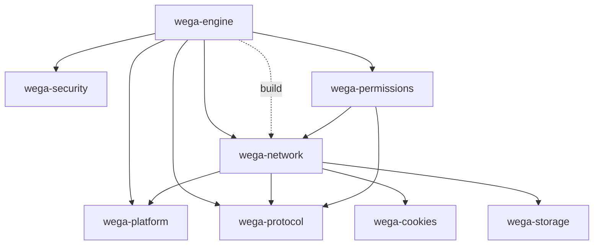

# Wave 1 implementation report

**Result: Wave 1 complete.** Tooling plus four extractions were implemented as five separate local commits on `feature/browser-cache-accessibility`. Nothing was pushed. Wave 2 has not been started.

## 1. Commits

| Step | Commit | Summary |
|---|---|---|
| Phase 2 plan docs | `165843d` | Finalized plan, `services/storage` rename, `webapi/{canvas,webgl,media}` (prepared before this wave) |
| 0 — documentation fixes | `c147bd3` | Module-map tree rebuilt (72 leaves, each group once), contract-dependency wording aligned, current-vs-adapter-only third-party table |
| 1 + 2 — baseline and tooling | `68e15e0` | `wega-dependency-graph`, `wega-architecture-check` (standalone workspace), baseline reports |
| 3 — cookies | `c2ad437` | `wega-cookies` |
| 4 — storage | `4f8ffdb` | `wega-storage` |
| 5 — security | `c312220` | `wega-security` |
| 6 — permissions | `0810bef` | `wega-permissions` |
| Report and status updates | see `git log -1 -- docs/architecture/wave1-implementation-report.md` | This report, after-graph, plan/module-map/migration-phases status |

## 2. Crates created

| Package | Path | Workspace | Class |
|---|---|---|---|
| `wega-dependency-graph` | `engines/tools/dependency-graph` | standalone `engines/tools` (own `Cargo.lock`), excluded from `engines` | dev tool (lib + bin) |
| `wega-architecture-check` | `engines/tools/architecture-check` | same | dev tool (bin), **report-only** |
| `wega-cookies` | `engines/services/cookies` | `engines` | library |
| `wega-storage` | `engines/services/storage` | `engines` | library |
| `wega-security` | `engines/services/security` | `engines` | library |
| `wega-permissions` | `engines/services/permissions` | `engines` | library |

All new crates: edition 2024, `rust-version 1.98`, MPL-2.0, `publish = false`, `#![forbid(unsafe_code)]`. No empty future-facing crates were created; no vendored code, dependency versions or CI files were modified.

Workspace isolation: `engines/Cargo.toml` gained `exclude = [..., "tools"]` plus the four service members; `.gitignore` ignores `/engines/tools/target`. `cargo_metadata 0.23.1` appears only in `engines/tools/Cargo.lock`.

## 3. Source files migrated

| From | To | Notes |
|---|---|---|
| `engines/network/src/cookies.rs` | `engines/services/cookies/src/lib.rs` | Verbatim; one added line (`#![forbid(unsafe_code)]`) |
| `engines/network/src/public_suffix_list.dat` | `engines/services/cookies/src/public_suffix_list.dat` | Pure rename |
| `engines/network/src/{cache_api,cache_storage,indexeddb}.rs` | `engines/services/storage/src/` | **100% renames**; new `lib.rs` declares the modules |
| `engines/wega/src/csp.rs` | `engines/services/security/src/csp.rs` | Only change: `pub(crate) struct Csp` → `pub struct Csp` |
| `trustworthy()` + its test from `engines/wega/src/security_context.rs` | `engines/services/security/src/secure_context.rs` | V8 `configure()` stays in the engine |
| `engines/wega/src/permissions/{device,registry}.rs` | `engines/services/permissions/src/` | `crate::network::NetworkPolicy` → `wega_network::Policy` (same type); one nested `if let` collapsed into a let-chain (see §8) |

Not moved (as decided): `network/src/cors.rs` (entangled with `network/src/lib.rs`), V8 `configure()`.

Non-code path updates required by the moves: `scripts/engine-web-mutations.py` (cookie mutation target path) and `NOTICE` (PSL file path). All 18 mutation targets in both mutation scripts were checked to still exist.

## 4. Dependency graph before and after

Before (4 members, 6 edges) — [`baseline/dependency-graph-baseline.md`](./baseline/dependency-graph-baseline.md). After (8 members, 12 edges) — [`baseline/dependency-graph-after-wave1.md`](./baseline/dependency-graph-after-wave1.md).

- No cycles (tool cycle check after every step; also unit-tested).
- `wega-cookies`, `wega-storage`, `wega-security` have **no** workspace dependencies (storage does not depend on network).
- The root crate still depends only on `wega-protocol`, `wega-platform`, `wega-network`.
- Architecture report: 0 violations before and after; the only differences are member/edge counts ([`baseline/architecture-check-after-wave1.md`](./baseline/architecture-check-after-wave1.md)). Informational findings (direct third-party engine dependencies of `wega-engine`; legacy crates without `forbid(unsafe_code)`) are unchanged, as expected.

## 5. Compatibility shims

| Old path | Now |
|---|---|
| `wega_network::{Cookies, CookieEntry, SiteContext}` | `pub use wega_cookies::{...}` in `network/src/lib.rs` |
| `wega_network::{cache_api, cache_storage, indexeddb, CacheEntry, CacheStorage, IndexedDB}` (modules and types) | `pub use wega_storage::{...}` in `network/src/lib.rs`; `crate::cache_api::…` inside `wega-network` still resolves |
| `wega_engine`-internal `crate::csp::Csp` | `engines/wega/src/csp.rs`: `pub(crate) use wega_security::csp::Csp;` |
| `crate::security_context::trustworthy` | `pub(crate) use wega_security::secure_context::trustworthy;` |
| `wega_engine::permissions::{device, registry, DeviceManager, DeviceTrack, DeviceWakeLock, MediaTrackKind, PermissionRegistry, RevocationResult}` | `engines/wega/src/permissions/mod.rs` re-exports `wega_permissions` |

Persistence compatibility: cookie, Cache Storage and IndexedDB code moved without semantic change (renames at 100% similarity; the only edits listed in §3), so `cookies.json`, SQLite schemas and file layouts are unchanged.

## 6. Lockfile review

Each step: the only `engines/Cargo.lock` changes were the new path package and moved dependency lines in `wega-network`/`wega-engine`. The root `Cargo.lock` gained entries for `wega-cookies` and `wega-storage` (reached through `wega-network`), not for `wega-security`/`wega-permissions`. **No external package version changed.** The first `cargo check` after each manifest change ran without `--locked` to update the lock; afterwards all validation used `--locked`.

## 7. Tests executed

Baseline (commit `c147bd3`) and final (HEAD) full runs: `cargo test --locked --manifest-path engines/Cargo.toml --target-dir target/wega-engine --workspace --all-targets --no-fail-fast -- --test-threads=1`.

| Run | Passed | Failed | Ignored | Test binaries |
|---|---|---|---|---|
| Baseline | 359 | **1** | 2 | 43 |
| Final | **360** | 0 | 2 | 47 (+4 new crates) |

The sets of test names are identical apart from module-path changes for the moved tests (362 entries in both; `diff` shows only the relocated `trustworthy` test). Test totals per moved crate: `wega-cookies` 4, `wega-storage` 5, `wega-security` 5, `wega-permissions` 0 (its tests live in `engines/wega/tests/permissions.rs`), tools 6 + 6.

Per-step checks (all green unless noted): `cargo check --workspace --all-targets`; crate tests; `wega-network --all-targets`; engine integration tests relevant to the step (`security`, `web`, `scripts`, `web_workers`, `worker`, `cache_api`, `storage`, `permissions`, `media`, `inherited_broker`, …); `cargo clippy --workspace --all-targets -- -D warnings`; `cargo fmt --all --check`; `cargo check --locked` for the root application; tool dependency-cycle/architecture report.

Final CI-equivalent validation:

- Full workspace tests: above.
- Broker mode: `WEGA_TEST_BROKER=1 cargo test … -p wega-engine --test security --test forms --test scripts --test documents --test history -- --test-threads=1` — all passed.
- Required-worker test (`inherited_broker::a_required_worker_runs_jit_storage_cookies_and_frames_through_grants -- --ignored`) — **passed** when given a content helper built the way CI builds it on macOS (`wega-content-bundle` → `Engine.app`, `WEGA_CONTENT_HELPER`). Without that variable it fails with "Missing native content helper" (environment, not code).
- Root: `cargo metadata --locked --no-deps`, `cargo check --locked`, and `cargo clippy --locked --no-default-features --all-targets -- -D warnings` pass. `cargo metadata` for both workspaces passes.
- Tools workspace: `cargo test --locked` (12 tests) and clippy `-D warnings` pass.
- Not run: the `native_sandbox` ignored platform test and the Windows/Linux CI jobs (unaffected paths).

## 8. Pre-existing failures vs regressions

| Item | Classification |
|---|---|
| `cache_api::cache_add_all_fetches_real_responses_atomically_and_reads_without_the_server` | **Pre-existing flaky test, not a regression (root cause since identified: a bug in the test's own fixture, see [`wave2-gate-report.md`](./wave2-gate-report.md) §Flaky test).** It failed 3 of 3 times at the baseline commit and then passed intermittently. A clean worktree of the baseline commit later passed 5 of 6 runs; HEAD passed 4 of 8 (plus a passing full-suite run). Failure output varies (`[TypeError, TypeError]` vs `[TypeError, InvalidStateError]`, or an overall `TypeError`). Failure rates at baseline (4 of 9 runs) and HEAD (7 of 13 runs) are statistically indistinguishable. The storage code moved without change, but because this test exercises it and its rate cannot be shown to be unchanged, it should be investigated separately. |
| `cargo fmt --manifest-path engines/Cargo.toml --check` ("Failed to find targets") | Command issue: `--all` is required for the workspace; the plan was corrected. |
| `tokio` deprecation warnings (`AsyncFd::new`, `set_linger`) and 8 `deno_core` warnings | Pre-existing, left untouched (not suppressed). Root crate: pre-existing unused-import warning (`GenericSender`). |
| Engine crate-wide `#![allow(clippy::collapsible_if, …)]` | Pre-existing. It masked a lint in code moved to `wega-permissions`; the nested `if let` was collapsed into an equivalent let-chain instead of adding an allow. Expect the same for later extractions. |

## 9. Build time and memory

All numbers are on an Apple M4 with a **warm** `target/wega-engine` cache (not clean builds) and include noise from incremental recompilation, so treat differences as indicative only.

| Measure | Baseline | Final |
|---|---|---|
| Full workspace test run, wall time | 375.2 s | 345.0 s |
| Same, max RSS / peak footprint | 1.47 GB / 177 MB | 1.47 GB / 181 MB |
| `clippy --workspace --all-targets` | 12.7 s, 530 MB RSS (baseline cache) | 10–28 s after each step (incremental; not separately measured for memory) |
| Root `cargo check --locked` | not measured | 7.7 s, 495 MB RSS (after Step 3) |

No measurable regression; clean-build timing and peak build memory were not practical to record in this environment.

## 10. Known limitations

1. **CI path filters (corrected by the Wave 2 gate report):** `.github/workflows/v8-engine.yml` lists `engines/network/**`, `engines/wega/**`, etc. but not `engines/services/**`. That workflow only builds `engines/v8-spike` and verifies vendored sources; the engine test suite runs through `ci.yml` → `standalone-engine-validation.yml`, scoped by `scripts/ci-scope.py`, whose `^engines/` rule already covers `engines/services/**`. So no engine test is skipped; only the optional v8-spike run is not triggered by changes confined to the new crates. CI files were not modified.
2. **`wega-permissions` → `wega-network`:** temporary coupling because the registry reads `Policy::blocked_hosts`; no new abstraction introduced.
3. **IndexedDB** moved with Cache Storage but has no in-repo consumer other than its tests.
4. **Unused duplicates left in place:** `engines/wega/src/public_suffix_list.dat` (no references found in sources, manifests, scripts, CI or docs) and the unused `cookie_store`/`publicsuffix` direct dependencies in `engines/wega/Cargo.toml`; deleting them was out of scope.
5. **Historical docs** (`docs/step-16-…`, `docs/standalone-feature-ledger.md`) still mention old file locations. The ledger also uses the label `wega-storage/` for an earlier planned feature; the new package of that name is unrelated.
6. **Dev-tool scope:** architecture check implements the rules listed in `engines/tools/architecture-check/src/rules.rs` (cycles, forbidden edges, contract independence, tool isolation, `forbid(unsafe_code)`, third-party-engine confinement). It is report-only and always exits 0 on findings.
7. Legacy crates (`wega-engine`, `wega-network`, `wega-platform`) do not declare `forbid(unsafe_code)`; reported as informational.
8. Root `Cargo.lock` now records two additional path packages; this is required because the root application depends on `wega-network`.

## 11. Readiness assessment for Wave 2

**Ready to begin gate work; not ready to migrate yet.** Positive: architecture tooling exists and runs against both workspaces; the extraction method (verbatim move + re-export + lockfile review + full test comparison) worked cleanly four times; baseline numbers exist.

Before Wave 2 implementation:

1. Run the Wave 2 gates (G2-JS, G2-SKIA, G2-DOM, G2-ARCH) as written inventories; none has been done.
2. Decide the `NativeHost` `Request`/`Response` type question (G2-JS).
3. Stabilise or quarantine the flaky `cache_api` test so it does not mask regressions during larger moves.
4. Plan for crate-wide clippy allowances in `wega-engine` (`collapsible_if`, `too_many_arguments`, …) that will surface when code moves into new crates.
5. Optionally extend CI path filters to cover `engines/services/**` and the future `engines/{javascript,adapters,...}/**` crates.
6. Wave 2 touches much larger and more coupled code (V8 glue ≈ 1.9k lines, workers ≈ 2.4k lines); keep one file group per commit.

Wave 2 was not started.
