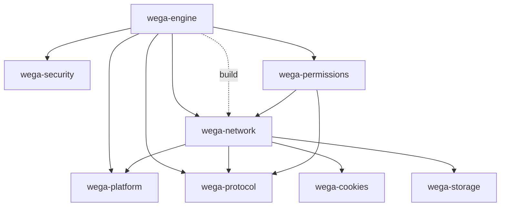
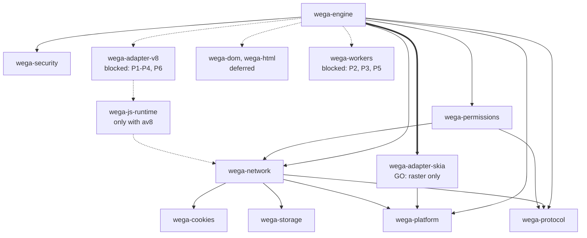

# Wave 2 architecture gate report

**Scope:** validate the Wave 2 architecture against the actual code. **No Wave 2 implementation, production Rust change, manifest/lockfile change, CI change or push was made.** All prototypes were built in scratch copies under `/tmp/wave2` (outside the repository) and are summarised here.

Repository state when the gates ran: branch `feature/browser-cache-accessibility`, HEAD `7c89ee9` (local, one commit ahead of `origin/feature/browser-cache-accessibility` at `0810bef`); worktree clean before this report. Toolchain `rustc 1.98.0`.

## 1. Executive decision matrix

| Package | Gate | Decision | One-line reason |
|---|---|---|---|
| `wega-adapter-skia` | G2-SKIA | **GO — limited to the raster path** | `raster.rs` is self-contained (no `crate::` references); prototype compiles and passes the Canvas/WebGL/image/page tests. Canvas 2D and WebGL stay as documented Skia exceptions. |
| `wega-js-runtime` | G2-JS | **NO-GO for Wave 2 (conditional)** | Technically viable (Option A prototype compiles and passes engine tests), but a trait-only crate whose only implementer and consumers stay in `wega-engine` adds a crate boundary without decoupling. Create it only together with `wega-adapter-v8` (or fold the traits into the adapter). |
| `wega-adapter-v8` | G2-JS | **NO-GO for Wave 2 (blocked by prerequisites)** | `V8Host::new` constructs the engine's `Dom`; the Deno glue depends on the engine's `Network`; `build.rs` path-includes V8 sources and reads root `tools/`/`vendor/`; `workers` share the snapshot; the only engine `unsafe` code lives in `v8.rs`. |
| `wega-dom` | G2-DOM | **NO-GO (deferred)** | The engine uses `Rc<RefCell<blitz_dom::BaseDocument>>` directly (≈86 `get_node` and 40 `mutate()` call sites). Any contract is either a mirror of Blitz's node API (per-node wrappers, duplicated state) or generic over Blitz types (no decoupling). |
| `wega-html` | G2-HTML | **NO-GO (deferred; depends on `wega-dom`)** | `parser.rs` is an `html5ever::TreeSink` over Blitz's `DocumentMutator`; only ≈100 lines (node budget, stepping, diagnostics) are Blitz-independent. |
| `wega-js-bindings` | G2-BINDINGS | **NO-GO (blocked)** | Generated-file paths are hard-wired in `tools/webidl/families.json`, `build.rs` staleness assertions and `native_ops.rs`; the snapshot build must move together with the V8 adapter. |
| `wega-workers` | G2-BINDINGS | **NO-GO (blocked)** | `Network` owns the worker hubs while workers depend on `Network` (in-crate cycle); `WorkerHost` depends on `canvas` and `webgl`, which are not extracted. |

**Net effect:** Wave 2 shrinks to one approved extraction (`wega-adapter-skia`, raster only) plus a test-fixture fix. The remaining packages need prerequisite refactors *inside* `wega-engine` first (§12), which require maintainer approval because they touch production code.

## 2. Step 0 — verification and reconciliation

| Check | Result |
|---|---|
| Branch / HEAD / remote | `feature/browser-cache-accessibility` / `7c89ee9` / `origin/...` = `0810bef` (verified with `git ls-remote`); ahead 1, behind 0. A `git fetch --dry-run` only listed an unrelated remote branch. No push, reset, rebase or ref change was performed. |
| Worktree | clean at start |
| Stale headings | Fixed: `docs/architecture/README.md` (was "PLANNED — NOT IMPLEMENTED"), `module-map.md` header, `crate-initialization-plan.md` header ("NOTHING IMPLEMENTED"). `migration-phases.md` and `wave1-implementation-report.md` updated (see §2.2). |
| Dependency graph regenerated | `wega-dependency-graph` from `engines/Cargo.toml` (see §2.1) |
| Architecture checker | `wega-architecture-check` on both workspaces: **0 violations**; 14 informational findings unchanged (direct third-party engine dependencies of `wega-engine`; legacy crates without `forbid(unsafe_code)`). Remains report-only. |

### 2.1 Actual graph (8 members, 12 edges)



Planned-vs-actual reconciliation:

| Planned edge (plan §6.3) | Actual | Action |
|---|---|---|
| `cookies → protocol`, `storage → protocol`, `security → protocol` | **absent** (these crates have no workspace dependencies) | Removed from the plan's graph (stale). |
| `permissions → network`, `permissions → protocol` | present | none |
| `network → cookies/storage` | present | none |
| `engine → security/permissions` | present | none |
| `engine -.build.-> network` | present but **not in the plan** | Explained: `build.rs` path-includes `native_ops.rs` which names `wega_network::Request`; see §4.3. |

### 2.2 CI path-filter question (`v8-engine.yml` vs `engines/services/**`)

- `v8-engine.yml` does not list `engines/services/**` (its filters: `engines/{v8-spike,wega,network,platform,protocol,vendor}/**`, manifests, scripts, docs).
- **But that workflow does not test the engine.** It builds `engines/v8-spike` (`working-directory: engines/v8-spike`) and verifies vendored sources and prebuilt V8 checksums.
- The engine suite runs through `ci.yml` → `standalone-engine-validation.yml` (`workflow_call`), whose scoping is `scripts/ci-scope.py` line 40: `(r'^engines/', ('lint', 'engine-validation') + DESKTOP)`, which **already covers `engines/services/**`** and every future `engines/*` directory.
- Conclusion: no engine test is skipped. The Wave 1 report's limitation 1 overstated the gap and was corrected.
- **Recommended patch (not applied)**, only if maintainers want the V8 spike/vendor workflow to react to the new crates:

```diff
--- a/.github/workflows/v8-engine.yml
+++ b/.github/workflows/v8-engine.yml
@@ pull_request.paths and push.paths (both blocks)
       - 'engines/protocol/**'
+      - 'engines/services/**'
+      - 'engines/adapters/**'
```

- Separate gap found: **no workflow runs the standalone `engines/tools` workspace tests** (`cargo test --locked --manifest-path engines/tools/Cargo.toml`). Recommend adding one lint/test step; `ci-scope.py` already routes `engines/` changes to `lint`.

## 3. G2-JS — JavaScript and V8 boundary

### 3.1 Reference inventory

Counts of matching lines (`grep`) in `engines/wega/src`:

| File (lines) | `deno_core` | `v8::` | `JsRuntime` | `NativeHost` | `ScriptHost` | `ModuleLoader` |
|---|---|---|---|---|---|---|
| `v8.rs` (838) | 17 | 9 | 6 | 2 | 2 | – |
| `script.rs` (85) | – | 1 | – | – | 3 | – |
| `native_ops.rs` (229) | 5 | – | – | 13 | – | – |
| `module_loader.rs` (87) | 3 | – | – | – | – | 4 |
| `web.rs` (172) / `web_extensions.rs` (20) / `extension_adapter.rs` (406) | 1 / 1 / 4 | – | – | – | – | – |
| `workers/runtime.rs` (770) | 4 | 4 | 3 | 2 | – | – |
| `security_context.rs` (51) | 3 | 8 | 1 | – | – | – |
| `main.rs` (1300) | 1 (`v8_set_flags`, line 72) | – | – | – | – | – |
| `broker_socket.rs` (206), `event_loop.rs` (84), `dom.rs`, `workers/{mod,service,shared,transfer}.rs`, `document_host.rs`, `components.rs` | 0 | 0 | 0 | 0 | 0 | 0 |

The Deno/V8 surface is concentrated in about nine files; `dom.rs`, `view.rs` and the worker coordination code never name Deno or V8 types. `view.rs` touches the runtime only through `Box<dyn ScriptHost>` (field `view.rs:312`, creation `view.rs:639` via `script::create`), calling (across `view.rs` and `document_host.rs`) `evaluate_json` 28 times, `freeze` 6, `allow_eval` 2 and each remaining method once.

### 3.2 Public API inventory

| Item (file:line) | Signature (abridged) | Dependencies | Callers | Lifecycle | Proposed owner |
|---|---|---|---|---|---|
| `ScriptError` `script.rs:9` | `struct { fatal: bool, message: String }` + `Display`/`Error` | none | v8.rs, view.rs | value type | contract (or adapter) |
| `HostContext` `script.rs:22` | `Rc<RefCell<BaseDocument>>`, `Network`, `Arc<RwLock<Csp>>`, dialog, permissions, started-scripts… | **Blitz `BaseDocument`/`NodeId`, engine `Network`/`DocumentDialogHandler`, `wega-security::Csp`, `wega-permissions::PermissionRegistry`** | view.rs, `V8Host::new` | per document | **stays in engine** |
| `ScriptHost` `script.rs:36` | 15 methods (`run`, `run_module`, `evaluate_json`, `checkpoint`, `tick`, `next_timer`, `freeze`, `allow_eval`, `budget`, `sync_nodes`, `history`, `heap_bytes`, `take_errors`, `modules_pending`, `take_requests -> crate::dom::Requests`, defaulted `frame`) | `take_requests` returns an engine type holding Blitz `NodeId` and `wega_protocol` types | `view.rs` (single object per view) | one per document; torn down on fatal limit | contract only if `Requests` becomes an associated type |
| `script::create` `script.rs:63` | `(HostContext, &Limits, usize) -> Result<Box<dyn ScriptHost>, String>` | `V8Host` | view.rs:639 | factory | engine (composition root) |
| `NativeHost` `native_ops.rs:44` | `fetch(Request)->Pin<Box<dyn Future<…Response…>>>`, `call(&[Value])->Result<Value,String>`, `cookie_header`, `cookie_response`, `document_origin`, `ws_headers`, `referrer`, `connect_check` | `wega_network::{Request,Response}`, `serde_json::Value` | 13 ops via `OpState`; impls: `Dom` (`v8.rs:19`), `WorkerHost` (`workers/runtime.rs:552`) | `Rc<dyn NativeHost>` stored in `OpState` for the runtime's life | contract (or adapter) |
| `op_wega_fetch` `native_ops.rs:174` | `async fn(Rc<RefCell<OpState>>, #[serde] wega_network::Request, #[buffer] JsBuffer) -> FetchResult` | **deserializes `wega_network::Request` straight from JS; builds `FetchBody` resource (`native_ops.rs:217`)** | JS `fetch` shim in `extension_adapter.rs` | per request | adapter |
| `wega_dom` extension `native_ops.rs:197` | `deno_core::extension!(wega_dom, ops=[13 ops])` | deno_core | `V8Host::new`, `workers/runtime.rs`, `build.rs` | registered per runtime and at snapshot build | adapter |
| `V8Host` `v8.rs:281`, `new` `v8.rs:300` | `new(HostContext, &Limits, usize) -> Result<Self,String>` | **constructs `Dom::new(context, …)` (v8.rs:313)**, `crate::web`, `module_loader`, `broker_socket`, `security_context::configure`, `STARTUP_SNAPSHOT` | `script::create` only | `!Send` (holds `Rc<Dom>`, `Rc<tokio Runtime>`); one isolate per document thread | adapter (after decoupling from `Dom`) |
| `impl NativeHost for Dom` `v8.rs:19` | `fetch` overrides origin/initiator/top_level/destination/redirect/limit, then `network.request(...)` | `Dom`, `Network` | ops | – | engine |
| `STARTUP_SNAPSHOT` `v8.rs:133` | `&[u8] = include_bytes!(OUT_DIR/wega-startup.bin)` | produced by `build.rs` | `v8.rs`, `workers/runtime.rs:217` | static | adapter (with `build.rs`) |
| `RawIsolateGuard` `v8.rs:154` | raw `*mut Isolate`, `enter`/`exit` | **the only `unsafe` code in the engine** (`#[allow(unsafe_code)]`) | GC/teardown paths | RAII | adapter (documented unsafe exception) |
| `Watchdog` `v8.rs:193` | terminate-execution thread with `IsolateHandle` | deno_core::v8 | `V8Host` | thread per host | adapter |
| `Loader` `module_loader.rs:10`/`:34` | `impl ModuleLoader`; `new(Network, &Url, usize)` | engine `Network::{remote, spawn, fetch}`, `FetchContext`, `Destination` | `V8Host::new`, `workers/runtime.rs:218` | per runtime | adapter, needs a `Network` abstraction |
| `web::permissions`/`extensions`/`BrokerStorage` `web.rs:106/122/147` | build Deno permissions/extensions from `Dom` and `wega_network::Remote` | `Dom`, `Network`, `wega_network` | `V8Host::new`, `workers/runtime.rs` | per runtime | adapter, needs injected inputs |
| `web_extensions::extensions` `web_extensions.rs:2` | ordered list of 7 Deno extensions | deno_* crates | `web.rs`, `workers/runtime.rs`, **`build.rs` (path-included)** | same order at snapshot build and restore | adapter |
| `adapt_extension` `extension_adapter.rs:4` | extension transpiler patching Deno sources | deno_core | `V8Host`, workers, **`build.rs`** | – | adapter |
| `broker_socket::Connector` `broker_socket.rs:22` | `impl deno_websocket::BrokerConnector` | engine `Network`, `wega_network::ResourceRequest` | `V8Host::new`, workers | per runtime | adapter, needs `Network` abstraction |
| `security_context::configure` `security_context.rs:4` | `(&mut JsRuntime, &Url) -> Result<(),String>` | `deno_core::v8` | `V8Host::new`, `workers/runtime.rs:269` | once per runtime | adapter |
| Worker runtime `workers/runtime.rs` | `Spec` (`:51`), `Handle::spawn` (`:84`), `run` (`:180`), `WorkerHost` (`:486`, `impl NativeHost` `:552`) | own OS thread and isolate per worker; uses `canvas`, `webgl`, `Network`, `Csp`, `STARTUP_SNAPSHOT` | `WorkerManager` in `Dom` | thread + `IsolateHandle` for termination | engine until prerequisites (§9) |
| `build.rs` | `#[path]`-includes `src/{extension_adapter,native_ops,web_extensions}.rs` and `../../tools/webidl/{ast,generate,manifest,parser}.rs`; reads root `vendor/servo-script-bindings/webidls/*`; reads `src/dom/*.js` relative to the crate; writes `wega-startup.bin` | `deno_core`, `wega-network` (build-dep), WebIDL tool sources | cargo | build time | adapter (moves with it) |

### 3.3 Coupling findings that decide the gate

1. `V8Host::new` builds the engine's `Dom` (v8.rs:313) and stores `Rc<Dom>`. `V8Host` uses `Dom` in only ~13 places (`begin_task`, `errors`, `requests`, `budget`, `set_allocated`, `history`, `network.{wake,policy,remote,storage_dir}`, document URL), so decoupling is possible, but it is a production refactor.
2. The Deno glue (`module_loader`, `broker_socket`, `web`) uses the engine's `Network` (`network.rs:162`): `remote`, `spawn(closure)`, `fetch(client, …)`, `policy`, `wake`. `Network` also owns the worker hubs (`network.rs:170-172`).
3. `build.rs` compiles V8-facing sources and WebIDL tool sources by `#[path]`, so the adapter must carry `build.rs` and the snapshot build (build-dependencies: the whole Deno stack plus `wega-network`).
4. `main.rs:72` sets process-wide V8 flags (`--lite-mode`) via `deno_core::v8_set_flags` before platform initialisation; the adapter would have to expose that.
5. `v8.rs` holds the engine's only `unsafe` code, so `wega-adapter-v8` cannot be `#![forbid(unsafe_code)]` without rewriting `RawIsolateGuard` (decision 10 allows a documented FFI exception).

### 3.4 Option A vs Option B for the host request/response types

Option A keeps `wega_network::{Request, Response}` in `NativeHost::fetch`. Option B introduces `HostRequest`/`HostResponse` with explicit conversions.

Facts: the JS side sends the **serde shape of `wega_network::Request`** (`op_wega_fetch` deserializes it; `extension_adapter.rs:304` builds the object); `Dom::fetch` (v8.rs:20) overwrites `origin`, `initiator`, `top_level`, `destination`, `redirect` and `limit`, so JS only controls `url`, `method`, `headers`, `credentials`, `cache`, `mode`. `Response::status_text()` uses `reqwest::StatusCode`. `Request.destination` is the `ResourceDestination` enum (11 variants, `rename_all = "lowercase"`).

| Criterion | Option A | Option B (measured in prototype) |
|---|---|---|
| Compilation coupling | `wega-js-runtime → wega-network` (reqwest, rusqlite, tokio…, ≈339 units already in the engine graph; **no new packages**) | `wega-js-runtime → serde, serde_json, url` only; the build script could drop `wega-network`. Compile-time saving **not measured** (features likely unify on one host triple). |
| API stability | Field changes in `Request` flow through automatically | A second wire schema to keep in sync with the JS shim; drift risk |
| Allocation / copying | none | Bodies **move** (pointer equality asserted); ~10.6 µs per full request round-trip (includes sample construction and two `serde_json::Value` conversions) vs 522 µs for cloning one 8 MiB body |
| Semantic fidelity | exact | `destination` enum becomes a string; an unknown string is a **new failure mode** (test `unknown_destination_is_a_new_failure_mode_in_option_b`); `status_text()` must be re-implemented or computed host-side |
| Migration complexity | re-export only; 4 sites edited in the prototype | new types, conversions (≈45 lines), edits in `op_wega_fetch`, `Dom::fetch`, response path, plus schema tests |
| Graph cleanliness | `js-runtime` depends on a service crate | cleaner, but only matters if `wega-js-runtime` exists |

**Recommendation: Option A.** It is the smallest safe change and preserves behaviour exactly. Option B buys graph cleanliness at the price of a duplicated wire schema; revisit only if a non-network consumer of the runtime contract appears.

### 3.5 Compile-checked prototype (Option A, plus Option B conversions)

Isolated scratch workspace: `rsync` copy of `engines/` (excluding `target`) plus the root files the engine path-includes (`src/{diagnostic_event.rs,page_state.js,resources.rs}`, `tools/webidl/`, a symlink to root `vendor/`), built with the shared `target/wega-engine` directory. Nothing was written to the repository.

Contents:

- New scratch crate `wega-js-runtime` (`forbid(unsafe_code)`; deps `serde`, `serde_json`, `url`, `wega-network` path) containing `ScriptError`, `NativeHost` (signatures identical to `native_ops.rs:44`), `ScriptHost` with **`type Requests`**, and an Option B `host_types` module.
- Engine edits (scratch only): `native_ops.rs` and `script.rs` re-export the traits; `type DynScriptHost = dyn ScriptHost<Requests = dom::Requests>`; `view.rs` and `script.rs` use it; `impl ScriptHost for V8Host { type Requests = dom::Requests; … }`; `wega-js-runtime` added to normal **and build** dependencies (because `build.rs` path-includes `native_ops.rs`).

Results:

| Check | Result |
|---|---|
| `cargo check -p wega-engine --all-targets` | pass (one unused-import warning from the scratch edit) |
| Existing `impl NativeHost for Dom` (real `fetch` callback, v8.rs:19-39) | compiles **unchanged** against the trait in the new crate |
| Lifecycle methods (`checkpoint`, `tick`, `freeze`, …) of `V8Host` | compile unchanged; `view.rs` needed only the `DynScriptHost` alias |
| `cargo test -p wega-engine --lib` | 25 passed (+4 Option B tests: 29) |
| `--test scripts --test web --test web_workers` | 8 + 10 + 11 passed |
| Option B conversion tests | wire shape identical for all 11 destinations; bodies moved without copy; unknown destination errors; round-trip 10.6 µs vs 522 µs per 8 MiB clone |
| Architecture checker on the scratch workspace | 0 violations (10 members, 17 edges) |

**Viability:** `wega-js-runtime` is **viable but conditional**: only as part of the adapter extraction. `wega-adapter-v8` is **blocked** until the prerequisites in §9 are done, because the trait crate alone cannot move `V8Host`, the Deno glue, `build.rs` or the snapshot.

## 4. G2-SKIA — rendering boundary

### 4.1 Inventory

| Location | Skia use | Notes |
|---|---|---|
| `raster.rs` (176 lines) | `anyrender::{ImageRenderer, PaintScene, Scene}`, `anyrender_skia::SkiaImageRenderer`, `skia_safe::graphics::purge_all_caches()` (line 50), `kurbo::Affine::IDENTITY` | No `crate::` references. Dedicated thread `wega-raster`; `Scene` moved to it over an `mpsc` channel; output `Pixels::{Owned(Vec<u8>), Shared{slot,sequence}}` into `wega_platform::FrameStore`. API: `Raster::{new,set_store,start,pending,take,wait,release}`. |
| `view.rs:325/366` | owns `Raster`; builds `anyrender::Scene` via `blitz_paint` (`view.rs:2278`, `:2344`); `take_painted`/`wait_painted` (`:2397/:2400`) | `Painted`/`Pixels` re-exported publicly (`lib.rs:45`, used by `src/main.rs:528-550`). |
| `canvas/*` (1,297 lines) | `skia_safe` `Path`, `PathBuilder`, `Paint`, `Matrix`, `Shader`, `gradient_shader`, `BlendMode`, `Font`, `Surface`, `surfaces::raster_n32_premul` (`context.rs:56`), `read_pixels` (`:311`), `raster_from_data(Data::new_copy)` (`:327`, `:388`) | CPU raster surfaces only. Drawing state (`state.rs`, `path.rs`, `style.rs`) is **expressed in Skia types**. |
| `webgl/*` (1,642 lines) | Skia only for PNG encoding of the colour buffer (`context.rs:787-801`, `Data::new_copy`) | The WebGL implementation is a software engine (`webgl/engine.rs`, 93 lines). |
| GPU | `grep` for `DirectContext`/`GrContext`/`gpu` in `canvas/` and `raster.rs`: **none** | There is no GPU context to preserve; nothing to lose from a CPU-only interface. |
| Build/CI | `skia-bindings` and `anyrender_skia` patched under `engines/vendor/blitz`; `scripts/skia-msvc-cache.py`, `ci.yml:486`, `cd.yml:326`, `standalone-engine-validation.yml:48` key caches on the vendored sources and build with `-p wega-engine` | Moving `raster.rs` does not change the vendored crates. |

### 4.2 Option comparison

| | A: raster-only adapter | B: shared adapter for raster + Canvas 2D + WebGL |
|---|---|---|
| Pixel-buffer ownership | unchanged (`Vec`/shared `FrameStore` slot) | a Canvas surface interface must expose pixel access without copies; today `get_image_data` copies via `read_pixels`, `put_image_data`/`draw_image` copy via `Data::new_copy` |
| Surface lifetime / thread affinity | one renderer on the `wega-raster` thread, display list moved in | Canvas contexts live in `RefCell`s of `Dom` (and `WorkerHost`) on document/worker threads; a shared surface abstraction must cover both |
| GPU | none present | none present |
| Interface needed | **already exists** (`anyrender::Scene` is backend-neutral) | a drawing API covering paths, paints, shaders, gradients, blend modes, fonts/measure, clip, matrices, hit-testing — a second 2D API with a single implementation; **cannot be validated against a second backend** |
| Image transfer | unchanged | would add conversion layers on hot paths |

**Decision:** B is impractical (it would re-implement Skia's drawing API behind a trait that has exactly one implementation). **Approve A as a limited extraction.** `canvas/*` and `webgl/context.rs` remain **explicit temporary exceptions**: the engine keeps its direct `skia-safe` dependency until a Canvas backend decision is made. Consequence for decision 2 ("sole Skia backend owner"): `wega-adapter-skia` owns the *rasterisation backend*; it is not yet the only crate naming `skia_safe`.

### 4.3 Prototype (scratch)

`raster.rs` copied verbatim into scratch crate `wega-adapter-skia` (only change `pub(crate) struct Raster` → `pub struct Raster`; `#![forbid(unsafe_code)]` holds), engine's `raster.rs` replaced by `pub(crate) use wega_adapter_skia::Raster; pub use wega_adapter_skia::{Painted, Pixels};`.

| Check | Result |
|---|---|
| `cargo check -p wega-engine -p wega-adapter-skia --all-targets` | pass (51 s first build) |
| `--test canvas2d --test webgl --test image_limits --test pages` | 8 + 1 + 13 + 8 passed |
| Remaining engine uses of `kurbo`/`anyrender_skia` | none outside `raster.rs` → both dependencies would move to the adapter (version-preserving) |
| Engine keeps | `skia-safe` (canvas/webgl), `anyrender` (`view.rs` builds `Scene`) |

## 5. G2-DOM — Blitz integration boundary

Lines referencing Blitz DOM types/APIs (`blitz_*`, `BaseDocument`, `NodeId`, `DocumentMutator`, `.nodes`, `get_node`, `.mutate()`): `dom.rs` 147, `view.rs` 74, `parser.rs` 32, `document_host.rs` 12, `script.rs` 3, `network.rs` 1; `raster.rs` none.

Findings:

- **Ownership:** `Rc<RefCell<BaseDocument>>` is shared by `HostContext` (`script.rs:23`), `Dom` (`dom.rs:47`), the view and the parser. `native_ops.rs` documents the invariant "no DOM borrow survives a JS callback".
- **API usage:** ≈86 `get_node(` call sites returning `&Node` (Blitz's node struct), ≈40 `mutate()` (`DocumentMutator`), pattern matches on `NodeData`/`SpecialElementData`, `TreeTraverser`, `query_selector(_all)`, `handle_dom_event`, scrolling, hover/focus, accessibility-tree builder, `resolved_style_value`. `html5ever::{QualName, LocalName, ns}` appear in `dom.rs` and `parser.rs`.
- **Wega-owned stable pieces:** `HostContext`, `Requests` (`dom.rs:27`, contains Blitz `NodeId` and `wega_protocol` types), `components::{Registry,ShadowTree}` (custom elements/shadow DOM semantics over Blitz ids), `Scheduler` in `event_loop.rs` (pure, no Blitz), public view API (`Frame`, `View`, `PageEvent`, `Pointer*`).
- **Performance-sensitive:** `get_node` lookups during JS DOM ops (`op_dom_read` goes through `NativeHost::call(&[Value])` with JSON arguments), tree traversal, style/layout resolution, `snapshot_node_and`.
- **Contract feasibility:** a `wega-dom` trait whose `get_node` returns Blitz's node is Blitz-typed; returning Wega node views means per-node wrappers and a second copy of node state; making it generic over `Node` leaves Blitz types in every signature. No Blitz-independent subset is large enough to be useful.

**Decision: `wega-dom` deferred.** Revisit only after a second DOM implementation or a measured need exists (Wave 3 / Blitz replacement).

## 6. G2-HTML — parser extraction

- `parser.rs` (335 lines): `Sink` implements `html5ever::tree_builder::TreeSink` with `Handle = blitz_dom::NodeId` (`parser.rs:23`, `:70`); mutation goes through `blitz_dom::DocumentMutator` (`:39`); `Parser::{new,step,write,is_finished}` (`:231-296`) adds incremental stepping and an `Step` enum (`:222`); `parse_fragment` (`:297`) is used by `dom.rs:1235`; `view.rs:6` consumes `Parser`/`Step`. Tree construction itself is done by `html5ever`; `blitz_html` is not used by the parser module (one-shot parsing there is replaced by this incremental sink).
- Meaningful Wega behaviour: node budget (`admit`/`overflowed`, `:44-:69`), incremental stepping, parse-error diagnostics (`:78`). It is about 100 lines.
- Extraction cost: public API would contain `NodeId`/`BaseDocument`/`DocumentMutator` unless a sink trait is introduced; that trait is the `wega-dom` mutation API that G2-DOM defers.

**Decision: deferred** (depends on `wega-dom`). Not viable now without Blitz types in the public API.

## 7. G2-BINDINGS — JavaScript bindings and workers

### 7.1 Assets, generated files and build coupling

| Item | Detail |
|---|---|
| JS assets | `src/dom/{semantics 5,116 lines, canvas 851, web 773, observers 699, worker 353, bindings 275, …}.js`; `generated/*.hooks.json` (3,503-line `hooks.json` plus per-family files) and `generated/*.js` |
| Include sites | `native_ops.rs:11` `include_str!("dom/generated/hooks.json")`; `v8.rs:134` `include_bytes!(OUT_DIR/wega-startup.bin)`; `v8.rs:384` `include_str!("dom/bootstrap.js")`; `v8.rs:828-829` `include_js_files!`/`include_lazy_loaded_js_files!` (test); `view.rs:657` `include_str!("../../../src/page_state.js")` (**root `src/`**) |
| `build.rs` | embeds 12 JS files by crate-relative path `src/dom/<file>`; asserts generated bindings and `hooks.json` are not stale against `tools/webidl` output; `#[path]`-includes `tools/webidl/{ast,generate,manifest,parser}.rs` and three engine sources; reads root `vendor/servo-script-bindings/webidls/*.webidl` |
| WebIDL tool | `tools/webidl/families.json` hard-codes outputs `engines/wega/src/dom/generated/…`; root `Cargo.toml` bin `wega-webidl` and the standalone `tools/webidl/Cargo.toml` package compile the same `main.rs`; `build.rs` is a **third** consumer by `#[path]`. (Resolves the earlier duplicate-entry-point question: the third consumer is why the location must stay frozen.) |
| Cross-boundary sources | `engines/wega/src/lib.rs:22` `#[path = "../../../src/diagnostic_event.rs"]`; `view.rs:657` `page_state.js`; `engines/platform/tests/browser_resources.rs:3` `#[path = "../../../src/resources.rs"]` |

### 7.2 Workers

- `workers/runtime.rs` `Handle::spawn` (`:84`) starts an OS thread per worker (`:101`) with its own isolate; termination uses an `Arc<Mutex<Option<IsolateHandle>>>` (`:79`, `:183`).
- `WorkerHost` (`:486`) implements `NativeHost` (`:552`) and owns `CanvasEngine`/`WebGLEngine` (`:504-505`), calling `canvas::host::host_call`/`webgl::host::host_call`.
- The runtime reuses `v8::STARTUP_SNAPSHOT` (`:217`), `web_extensions::extensions` (`:214`), `module_loader::Loader` (`:218`), `web::{permissions,adapt_extension}`, `broker_socket::Connector` (`:248`), `security_context::configure` (`:269`) and `network::{referrer,mixed_content}`.
- `Network` (`network.rs:162`) **owns** `shared_workers`, `port_hub` and `service_workers` (`:170-172`) while `workers/*` depend on `Network` (`workers/mod.rs`, `service.rs`, `runtime.rs`): an in-crate cycle. `Dom` owns `WorkerManager` (`dom.rs:71`).
- Broker-mode security: worker traffic uses `Network.remote` (broker) and `spawn_detached` so worker requests do not queue behind the document; the `inherited_broker` tests and `WEGA_TEST_BROKER=1` runs cover it.

### 7.3 Can `wega-js-bindings` / `wega-workers` depend on `wega-js-runtime` without a reverse dependency on `wega-engine`?

- **`wega-js-bindings`: not yet.** The bindings are JS files plus generated hook tables consumed by `build.rs` and `native_ops.rs`; separating them from the V8 adapter would split the snapshot build across crates and require changing `tools/webidl/families.json`, staleness assertions and the pinned inputs. No Rust code is large or independent enough to justify a crate.
- **`wega-workers`: no.** Blocked by the `Network`↔`workers` cycle and by `WorkerHost`'s direct use of `canvas`/`webgl`; extracting it first would force `wega-engine` back into the workers crate.

## 8. G2-ARCH — dependency and compilation validation

For each proposed crate (the first row is the only approved one):

| Crate | Exact proposed dependencies | Existing consumers / reverse deps | Cycles / forbidden edges | Type-level vs compile-level independence | Large-package impact | Public API change / re-exports | Validation / platform risk |
|---|---|---|---|---|---|---|---|
| `wega-adapter-skia` (**GO**) | `wega-platform` (path), `anyrender =0.14.0`, `anyrender_skia =0.12.0`, `skia-safe =0.153.3`, `kurbo =0.13.1`; `#![forbid(unsafe_code)]` holds | `wega-engine` only (`view.rs`, `lib.rs:45`); root crate unaffected | none (checker: 0 violations; only the composition root depends on an adapter) | Compile-level: pulls `skia-bindings`/`skia-safe` (C++), same as today; moves, not adds | none new; engine drops `anyrender_skia` and `kurbo` direct deps | `Raster` `pub(crate)`→`pub`; shim `raster.rs`: `pub use …::{Painted, Pixels}` keeps `wega_engine::{Painted, Pixels}` | tests: canvas2d, webgl, image_limits, pages + full suite; Windows MSVC Skia cache keys and `-p wega-engine` build scripts (`skia-msvc-cache.py`, `ci.yml:486`, `cd.yml:326`) must be re-checked; Linux needs fontconfig/freetype as today |
| `wega-js-runtime` (deferred) | Option A: `serde`, `serde_json`, `url`, `wega-network` | engine (`script.rs`, `native_ops.rs`, `v8.rs`, `workers/runtime.rs`); also a **build-dependency** (`build.rs` path-includes `native_ops.rs`) | none | type-level: traits only; **compile-level: depends on `wega-network`** (reqwest/rusqlite/tokio). Option B removes this | none new | re-export traits at old paths | V8 workflow must stay green |
| `wega-adapter-v8` (blocked) | `deno_core =0.413.0`, `deno_error`, `deno_webidl`, `deno_web`, `deno_fetch`, `deno_websocket`, `deno_webstorage`, `deno_crypto`, `deno_permissions`, `deno_net`, `deno_tls`, `sys_traits`, `tokio`, `serde*`, `url`, `sha2`, `wega-js-runtime` (or own traits), a `Network`/host abstraction, `wega-network` | engine (`v8.rs`, workers, `build.rs`) | would create a cycle if it depended on engine `Network`/`Dom` | compile-level: moves the entire Deno stack (≈11 crates, build-dependencies too) | high: also the build-script snapshot | all current `crate::v8/web/module_loader/broker_socket/native_ops` paths | `v8-engine.yml` vendor verification, Deno snapshot reproducibility, unsafe exception (`RawIsolateGuard`) |
| `wega-dom` / `wega-html` (deferred) | n/a (no viable contract) | – | – | would be Blitz-typed | – | – | – |
| `wega-js-bindings` / `wega-workers` (blocked) | n/a | – | `workers` ↔ `Network` cycle | – | – | – | – |

Notes: (a) no scratch crate was added to the production workspace; (b) the checker accepts the prototype graph; (c) `wega-engine` also compiles three root-`src` files by relative path, so any crate move must keep those inputs reachable.

## 9. Prerequisites for the deferred packages (not approved, for maintainer review)

These are in-engine refactors, each requiring the full Wave 1 validation set. None is started.

| # | Prerequisite | Unblocks |
|---|---|---|
| P1 | Make `V8Host::new` receive an injected host (`Rc<dyn NativeHost>` plus a small environment struct for URL, wake callback, policy, remote/storage settings) instead of constructing `Dom` | `wega-adapter-v8` |
| P2 | Replace the Deno glue's use of `Network` (`module_loader`, `broker_socket`, `web`) with a narrow trait (`remote()`, `spawn(closure)`, `fetch(...)`) | `wega-adapter-v8`, `wega-workers` |
| P3 | Break the `Network`↔`workers` cycle (e.g. keep hubs outside `Network` and inject them) | `wega-workers` |
| P4 | Decide the snapshot-build layout (`build.rs`, `src/dom/*.js`, `tools/webidl` outputs, root `vendor` inputs) | `wega-adapter-v8`, `wega-js-bindings` |
| P5 | Decide whether Canvas/WebGL get a backend-neutral surface or remain permanent Skia exceptions | complete Skia ownership; `wega-workers` |
| P6 | Decide the unsafe policy for `RawIsolateGuard` (documented exception vs safe rewrite) | `wega-adapter-v8` |

## 10. Proposed dependency graph

Approved for Wave 2 (solid) and conditional/future (dashed):



## 11. Flaky Cache API test investigation

Test: `engines/wega/tests/cache_api.rs` `cache_add_all_fetches_real_responses_atomically_and_reads_without_the_server` (lines 168-290). Nothing in the production test was changed; instrumentation and the fix were applied only to a scratch copy.

### 11.1 Failure signatures observed

`failures` array `["TypeError","TypeError"]` instead of `["TypeError","InvalidStateError"]`; `failures: ["Error","InvalidStateError"]`; overall `{"error":"TypeError","message":"Cache.addAll received an unsuccessful response"}`; overall `{"error":"Error","message":"error sending request for url (http://127.0.0.1:…/asset)"}`.

### 11.2 Mechanism (proved)

The fixture binds a **non-blocking** `TcpListener` (line 190). On **macOS/BSD accepted sockets inherit the listener's non-blocking mode** (observed here); on Linux they do not, and Windows is expected to behave like BSD (inferred, not run). The fixture then reads the request one byte at a time with `read_exact`, treating any error as "end of request". On a non-blocking socket with no data yet, `read_exact` returns `WouldBlock` immediately, so the fixture logs `empty request`, answers **404** (anything other than `/asset` is "missing") and closes — before the client's request bytes arrive. Consequences: a real `GET /asset` receives 404 (→ `TypeError: unsuccessful response`) or the connection is closed under the client (→ reqwest "error sending request", which surfaces as `Error`).

Evidence:

1. **Instrumented run** (scratch copy with `TRACE` lines at `Dom::fetch`, `send()` start/finish and the fixture): in a passing run the first request (`GET /` from `create_view`) is logged by the fixture as `empty request` while the client received `404 Not Found` — i.e. the server replied before reading the request. In the failing run the `/missing` request of the first `addAll` returned `ERR … SendRequest` right after an `empty request`, and the final assertion saw `failures:["Error",…]`.
2. **Deterministic reproduction outside Wega** (`/tmp/wave2/repro`, plain reqwest 0.12.28 plus the same fixture): a client that connects, waits 30 ms and then writes `GET /asset` gets **404 5/5** with the original fixture (server saw 5 `empty request`s) and **200 5/5** once the accepted stream is set blocking. (A tight reqwest loop only hit the race once in 200 rounds, which is why the engine test, with slower request writes, fails far more often.)
3. **Fix verified on the real test:** adding `stream.set_nonblocking(false).unwrap();` after `accept()` in the scratch copy gave **0 failures in 40 runs and 0 `empty request` lines**, versus ≈20-35% failures before.
4. The same repository already uses this idiom in every other fixture (`network/tests/{security,broker,support}`, `wega/tests/{web,inherited_broker,support}`, `network/src/lib.rs:2019` all call `set_nonblocking(false)` after `accept`); only `cache_api.rs` omits it.

### 11.3 Is it a Wave 1 regression?

Not classified by failure rate alone:

- **Mechanism is independent of the changed code.** The failing behaviour is produced by the test fixture's socket handling, not by cookies/storage/security/permissions code.
- **Same signature at both revisions.** In 20 runs of the baseline commit (`c147bd3`) 4 failed (20%); in 20 runs of HEAD 7 failed (35%); Fisher exact `p = 0.48`. Every failing baseline run shows the same `empty request` pattern in the later fetches.
- **Not an effect of the storage move:** the Cache API storage calls are not on the failing path (the failures occur before/while fetching).

Conclusion: pre-existing test-fixture bug, evidenced by mechanism and by a fix that removes the failures.

### 11.4 Proposed deterministic fix (not applied)

```diff
--- a/engines/wega/tests/cache_api.rs
+++ b/engines/wega/tests/cache_api.rs
@@ fn cache_add_all_fetches_real_responses_atomically_and_reads_without_the_server
                 Ok((mut stream, _)) => {
+                    // Accepted sockets inherit O_NONBLOCK from the listener on macOS/BSD and Windows.
+                    stream.set_nonblocking(false).unwrap();
                     stream
                         .set_read_timeout(Some(Duration::from_secs(2)))
```

Optional hardening (not needed for the evidence above): do not reply to a connection that sent zero bytes.

### 11.5 Separate product finding (not changed)

In two failing runs a transport failure surfaced from `cache.addAll` with name **`Error`** rather than **`TypeError`**. Network failures in `fetch`/`Cache.addAll` should reject with `TypeError`; `op_wega_fetch` maps failures with `JsErrorBox::generic` (`native_ops.rs:174-195`). This is a conformance gap worth a separate ticket and test; it does not cause the flakiness.

## 12. Recommended implementation order

1. **Fix the fixture** (§11.4) as its own small change. Validate: 40 consecutive `cache_api` runs with 0 failures.
2. **`wega-adapter-skia`, raster only** (go). One commit: add crate, move `raster.rs`, shim, move `anyrender_skia`/`kurbo` dependency lines, workspace member, lockfile (new path package only).
3. **Maintainer decisions** on §9 (P1-P6) and on the open questions below; no code until approved.
4. If approved, in-engine prerequisites P1-P4 (each a separate commit with the full Wave 1 validation set), then re-run G2-JS/G2-BINDINGS gates, then `wega-adapter-v8` (+ `wega-js-runtime` if still wanted).
5. `wega-workers` only after P2, P3 and P5.
6. `wega-dom`/`wega-html`: defer to Wave 3 or later.

## 13. Explicit go/no-go

| Package | Go/No-go | Conditions |
|---|---|---|
| `wega-adapter-skia` | **GO** | raster-only; Canvas/WebGL documented exceptions; full engine suite + Skia platform checks |
| `wega-js-runtime` | **NO-GO** | revisit with `wega-adapter-v8`; if created use Option A |
| `wega-adapter-v8` | **NO-GO** | P1-P4 and P6 |
| `wega-dom` | **NO-GO** | no viable contract |
| `wega-html` | **NO-GO** | needs `wega-dom` |
| `wega-js-bindings` | **NO-GO** | P4 and adapter-v8 |
| `wega-workers` | **NO-GO** | P2, P3, P5 |

## 14. Validation commands and rollback requirements

Baseline set for every future extraction (from the Wave 1 report; `fmt` needs `--all`):

```sh
E=(--locked --manifest-path engines/Cargo.toml --target-dir target/wega-engine)
cargo metadata --no-deps --format-version 1 >/dev/null
cargo metadata --no-deps --format-version 1 --manifest-path engines/Cargo.toml >/dev/null
cargo fmt --manifest-path engines/Cargo.toml --all --check
cargo clippy "${E[@]}" --workspace --all-targets -- -D warnings
cargo test   "${E[@]}" --workspace --all-targets --no-fail-fast -- --test-threads=1
WEGA_TEST_BROKER=1 cargo test "${E[@]}" -p wega-engine --test security --test forms --test scripts --test documents --test history -- --test-threads=1
# required-worker test needs the content helper built as in CI:
cargo build "${E[@]}" -p wega-engine --bin wega-engine; cargo build "${E[@]}" -p wega-platform --bins
cargo check --locked    # root application
cargo run -q --manifest-path engines/tools/Cargo.toml -p wega-architecture-check -- --manifest-path Cargo.toml --manifest-path engines/Cargo.toml
```

Extra for `wega-adapter-skia`: `--test canvas2d --test webgl --test image_limits --test pages`; review `scripts/skia-msvc-cache.py` and the Windows jobs.

Rollback: one commit per extraction; revert that commit; keep re-export shims until the cleanup phase; compare lockfile diffs (new path package only); never mix a prerequisite refactor with an extraction in one commit.

## 15. Unresolved decisions requiring maintainer approval

1. Accept the reduced Wave 2 scope (only `wega-adapter-skia`) and the deferral of the other six packages.
2. Approve (or reject) the in-engine prerequisite refactors P1-P6 and their order; they change production code.
3. If `wega-adapter-v8` proceeds: host traits in the adapter, or a separate `wega-js-runtime` (Option A recommended)?
4. Treat Canvas 2D and WebGL's direct Skia use as permanent exceptions, or invest in a backend-neutral surface? Should WebGL stop using Skia only for PNG encoding (would add a dependency such as `png`)?
5. Unsafe policy for `RawIsolateGuard`: documented exception for `wega-adapter-v8` or a safe rewrite?
6. Approve the fixture fix (§11.4) and open a ticket for the `Error`-vs-`TypeError` conformance gap (§11.5).
7. Apply the optional CI changes (§2.2): `v8-engine.yml` path additions and a job for the `engines/tools` workspace tests.
8. The engine build and tests depend on root files by relative path (`src/diagnostic_event.rs`, `src/page_state.js`, `src/resources.rs`, `tools/webidl`, `vendor/servo-script-bindings`): treat these as stable shared inputs, or relocate them before any crate move?

Items that cannot be resolved from the repository: the maintainers' appetite for P1-P6; whether Canvas/WebGL should ever be backend-neutral; whether a second JS engine or DOM implementation is planned (which would justify `wega-js-runtime`/`wega-dom`); Windows behaviour of the flaky fixture was inferred from platform socket semantics, not run.

## Appendix A — Prototype sources and where they live

Scratch only (not in the repository): `/tmp/wave2/scratch` (engine copy with `wega-js-runtime` and `wega-adapter-skia` prototypes, Option B conversions in `engines/wega/src/proto_b.rs`, tracing and the fixture fix), `/tmp/wave2/repro` (reqwest repro), `/tmp/wave2/flaky*` and `/tmp/wave2/trace` (run logs).

Trait crate (Option A, abridged from the prototype):

```rust
#![forbid(unsafe_code)]
pub trait NativeHost {
    fn fetch(&self, request: wega_network::Request)
        -> Pin<Box<dyn Future<Output = Result<wega_network::Response, String>>>>;
    fn call(&self, args: &[serde_json::Value]) -> Result<serde_json::Value, String>;
    fn cookie_header(&self, address: &str, include: bool) -> String;
    fn cookie_response(&self, address: &str, include: bool, value: &str);
    fn document_origin(&self) -> String;
    fn ws_headers(&self, address: &str) -> Vec<(String, String)>;
    fn referrer(&self, address: &str) -> String;
    fn connect_check(&self, address: &str) -> String;
}
pub trait ScriptHost {
    type Requests;                       // engine's dom::Requests
    fn run(&mut self, source: &str, name: &str) -> Result<String, ScriptError>;
    /* run_module, modules_pending, evaluate_json, checkpoint, tick, next_timer,
       heap_bytes, take_errors, freeze, take_requests -> Self::Requests,
       allow_eval, budget, sync_nodes, history, defaulted frame */
}
```
